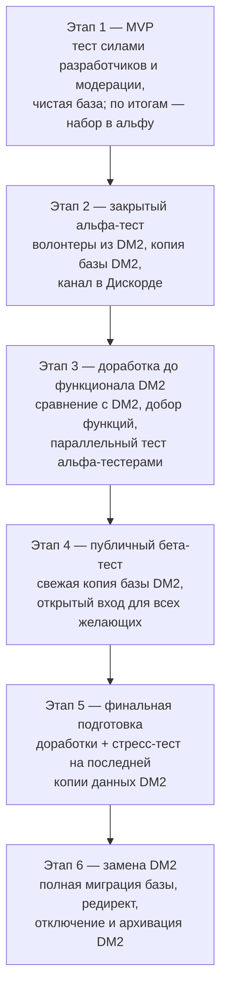
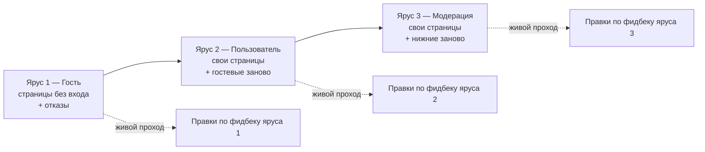

# DM3 — Прогресс реализации

Спутник к [Документация_по_разработке_DM3.docx](Документация_по_разработке_DM3.docx)
(полный план). Здесь — функциональная полнота и инвентарь страниц, разложенные по
ярусам доступа: в этом порядке функционал открывается тестировщикам.

**Статус зоны — одна отметка.** Состояния идут по возрастанию готовности и
исключают друг друга:

| Отметка | Значит |
|---------|--------|
| ⬜ | не начато |
| 🟡 | частично: часть зоны работает, часть нет — что именно, сказано в заметке |
| 🔎 | построено и покрыто тестами, владелец глазами не смотрел |
| ✅ | построено и осмотрено владельцем |

Зеленые тесты сами по себе ✅ не дают. Между 🔎 и ✅ стоит живой осмотр, потому
что верстку, текст и поведение на экране автотесты не судят — этот класс
дефектов ловится только глазом.

---

## Порядок запуска

Полный план перехода — раздел 7 docx, шесть этапов. Ярусы ниже — внутренняя
структура только первого из них: базовое тестирование силами разработчиков и
модерации на чистой сидовой базе. Альфа и бета тестируют сайт целиком, уже на
копии базы DM2.

Перед каждым тестовым этапом база DM3 очищается и заменяется актуальной копией
DM2 — тестовые данные не накапливаются. Ни один этап не начинается, пока не
закрыты критические ошибки предыдущего.

### Этап 1 изнутри: ярусы доступа

Внутреннее тестирование идет ярусами: сначала все, что видит гость, затем то,
что открывает вход, затем модерация и администрирование. Ярус не считается
сданным, пока по нему не прошли живые люди.

Ярус — это набор проверок, а не набор страниц. Проверка — пара "страница плюс
роль": одна и та же комната для гостя это текст, для игрока — форма письма,
броски и оценки чужих постов, для модератора — правка любого поста. Поэтому
ярус состоит из двух частей: страницы, которые на нем открываются впервые, и
повторный осмотр страниц нижних ярусов, чей опыт на этом ярусе меняется.
Инвентарь ниже перечисляет первую часть, разделы "Повторный осмотр" — вторую.

Впервые страница открывается там, где ее пускает гейт маршрута: ярус 2 — это
`requiresAuth` в `app/providers/router.ts`, ярус 3 — `requiresAuth` плюс
поддерево `/moderation` (флаг `moderationZone` включает сайдбарную панель,
маршрут он не закрывает).

Часть страниц открыта маршрутом, но закрыта внутри компонента: гость, открывший
настройки игры, видит отказ, а не форму. Такие помечены в инвентаре, и на первом
ярусе у них осматривается ровно один экран — сам отказ: внятен ли он, не торчит
ли под ним часть формы, предлагает ли войти. Содержимое этих страниц смотрится
на том ярусе, где роль зрителя его открывает.

---

## Функциональные зоны

### Ярус 1 — доступно гостю

Назначен проход владельца с нуля по всему ярусу: чек-лист со страницами и
проверками — артефакт "Проход первого яруса". **Проход не состоялся ни разу**,
поэтому весь ярус стоит в 🔎. Осмотренная зона переходит в ✅ поштучно, по ходу
прохода.

| Зона | Статус | Заметки |
|------|--------|---------|
| Главная, О проекте, Правила, Правовые | 🔎 | |
| Отзывы о сайте | 🔎 | |
| Опросы | 🔎 | |
| Статистика сайта | 🔎 | 8 топ-десяток: игроки, игры и блоги по оценкам и по активности, по объему игроки и авторы блогов; период в URL, пикер месяца/года с 2007, серверные positive-only ранги с делеными местами, кэш закрытых периодов |
| Сообщество | 🔎 | |
| Пульс | 🔎 | лента оцененных постов с фильтром и сортировками |
| Профиль + подстраницы | 🔎 | вкладки about/games/blogs/topics/achievements внутри страницы; рецензии, рекомендации, оцененные, загруженное — отдельные страницы |
| Лог предупреждений | 🔎 | открытый лог предупреждений вместе с исправленными до нуля, тот же список сужается до одного пользователя; запись красная с баллами и серая без них, показан текст на момент выдачи, у записи за профиль снимок профиля (аватар, статус, "О себе"), причина с разметкой; модераторская сторона стоит в ярусе 3 |
| Награды и достижения | 🔎 | награды timeless + серии; достижения — цепочки по метрикам |
| Форум | 🔎 | индекс, раздел, топик; на всех уровнях заголовок "Форум", на разделе и топике под ним полоса разделов |
| Каталоги игр и блогов | 🔎 | |
| Игровая зона на чтение | 🔎 | инфо, комнаты, персонажи, обсуждение, рецензии, оценки постов |
| Блог-зона на чтение | 🔎 | зеркало игровой: инфо, лента, обсуждение |
| Отказы яруса | 🔎 | девять адресов, где гостю показывать нечего: проверяется одно — отказ честен и неотличим от несуществующего объекта |
| Глобальный чат на чтение | 🔎 | эвент-баннер на осмотр владельцу |
| Обращения без входа | 🔎 | поддержка, жалобы, отслеживание по токену; гостевой email обязателен; по токену гость читает переписку обращения и пишет в нее |
| Страницы ошибок | 🔎 | по указанию владельца не трогались, кроме дефолтной картинки |
| Мобильная версия | 🔎 | телефон это полная версия, как DM2: страница раскладывается шириной 706 и уменьшается, средняя колонка как на 1366, своих перестроек у телефона нет (ни кнопок столбцом, ни ушедших столбцов таблиц); на 1000 и уже одна кнопка с тремя полосами у левого края шапки и одна выдвижная панель с вкладками "Меню" (меню разделов и левая колонка) и "О сайте" (статистика и правая колонка), над футером блоков нет, футер полный, настройки у шестеренки столбика на любой ширине; финальный осмотр за владельцем |

### Ярус 2 — открывает вход

Осмотра владельцем не было; проход организуется после закрытия яруса 1, тем же
форматом (чек-лист страниц с проверками).

| Зона | Статус | Заметки |
|------|--------|---------|
| Аутентификация | 🔎 | вход, регистрация, восстановление, сброс, подтверждение; honeypot + тайминг антибот; вход в два шага, если включена двухфакторная аутентификация |
| Настройки аккаунта | 🔎 | смена имени через модерацию; двухфакторная аутентификация: включение по QR или строке секрета, резервные коды, отключение и перевыпуск; черный список таблицей с корзиной и строкой добавления под таблицей, без окна; каналы Telegram и Discord строками в рамке с состоянием и одной кнопкой, сессии строками в рамке с "Завершить" справа |
| Личные сообщения | 🔎 | видом десктопного Telegram: лента общего чата, строка переписки с поиском и меню "…" (профиль, очистка истории для себя, выход из группы), список переписок справа с узким состоянием |
| Уведомления, подписки | 🔎 | уведомления таблицей "Событие \| Где \| Кто \| Когда": заголовок и адрес от сервера, непрочитанное жирным, открытие отмечает прочитанным, прочитанное остается в списке; на /subscriptions не ведет ни одна ссылка сайта |
| Личный блокнот | 🔎 | на /notepad не ведет ни одна ссылка сайта |
| Мои обращения | 🔎 | свои обращения видом топика от нового к старому, в тексте только написанное пользователем, "Ответы (N)" ссылкой, красная "*" у ждущего ответа автора; страницы листаются на сервере, фильтров нет; страница обращения с ответами компактными комментариями и формой, туда же ведут уведомления об ответе модерации и о закрытии |
| Создание блога и публикаций | 🔎 | |
| Создание игры и схема ее атрибутов | 🔎 | форма создания и настроек рядами, как на DM2, игра создается оформляющейся по умолчанию; у каждой игры своя схема атрибутов: форма создания отправляет ее вместе с игрой одним запросом, в настройках игры раздел "Система атрибутов" открыт тем же, кому открыто редактирование игры |
| Создание и правка персонажей | 🔎 | схема 6 типов атрибутов, персонаж 4 статуса + 3 флага |
| Письмо в игру, оценка постов, рецензии | 🔎 | открытость комнаты про чтение: пишут в любой комнате ведущие и те, кому выдан доступ "Может писать", доступы выдаются и в открытой; форма поста и строка бросков как на DM2, комната постов без правой колонки |

### Ярус 3 — модерация и администрирование

Осмотра владельцем не было; проход организуется после яруса 2, тем же форматом.

| Зона | Статус | Заметки |
|------|--------|---------|
| Панель модерации | 🔎 | контекстный сайдбар, одна панель из таблицы разделов четырьмя группами без подзаголовков, через пустую строку, пустая группа не рисуется, открытый раздел жирный, вкладок и страницы "Обзор" нет, раздел без прав отвечает 403; 6 диалогов на общем примитиве, вид изменился — на осмотр |
| Предупреждения и баны | 🔎 | варны 0-6; на 6 баллах автобан на 48 часов от системного аккаунта, дальше решает старший модератор; страница банов записями в формате DM2 по событиям выдачи и снятия, без цвета, с "Примечанием от модератора" цитатой и номером записи ссылкой, с поиском по имени, "Снять бан" по признаку сервера; предупреждение за профиль хранит снимок профиля, картинку из записи модерация удаляет из модераторского лога, кроме записи о самом модераторе |
| Премодерация игр и блогов | 🔎 | Mentor+ |
| Обращения | 🔎 | единая модель Ticket: 9 подтипов, 4 статуса, переписка ответами до ста, без назначения; одна очередь "Обращения" у модерации, статус выбирается вместе с ответом, закрыть можно без текста, наказаний в обращении нет; обращение видит модератор, чьей роли открыта причина, нарушитель жалобу на себя не видит; гостевой по токену |
| Наставничество | 🔎 | панель наставника; назначить себя наставником с сайта нельзя, ручка есть только в API |
| Награды, достижения, теги, сбор средств | 🔎 | |
| Шаблоны схем атрибутов | 🔎 | каталог стартовых анкет с одним шаблоном по умолчанию; список, создание и правка живут в разделе модерации, форма создания игры открывается шаблоном по умолчанию |
| Смена имен, загруженное, нарушители | 🔎 | |
| Отключение двухфакторной аутентификации у коллеги | 🔎 | вторым администратором с профиля; быстрый путь без недельной отсрочки почтового отключения |
| Боты и вебхуки | 🔎 | единый путь `/v1/webhooks/{type}`: Telegram по секрету в заголовке, Discord по официальному контракту Interactions (подпись Ed25519, ответ на `/connect` из интеракции) |

---

## Инвентарь поверхностей

Каждая страница, окно и служебный адрес одной строкой, с кликабельными адресами
и пометкой, на каких ярусах поверхность смотрится глазами:
**[SURFACES.md](SURFACES.md)**. Сколько их и каких, считает сам инвентарь.

Там же — что именно искать на каждом ярусе.

---

## Гейты

Числа тестов и объемы сида здесь не хранятся: они меняются с каждой правкой и
устаревают быстрее документа. Что гонять до пуша и в каком порядке, знает
`scripts/hooks/pre-push`, там же сказано, какие джобы воркфлоу оставлены за CI.
Текстовые правила (буква "е", кавычки, разделители) держат тесты фронта, а не
строка в этом документе.

## Не достроено по коду

Снимок по проходу по роутеру, страницам, ручкам и пометкам TODO; обновляется
вместе с зонами выше.

Страницы без входа с сайта, открываются только адресом:

- `/subscriptions`, подписки.
- `/notepad`, личный блокнот (заметки игры и блога при этом линкуются из
  панелей).

Частично:

- `/game/:id/post-reviews`: фильтра по комнате нет, запрос постов комнату не
  принимает.
- Страницы ошибок: отдельных иллюстраций для 404, 409 и 410 нет, стоит общая
  (план в ERROR_PAGES_AND_LORE.md).

Только сервер, клиента нет:

- Поиск по форуму (`GET /v1/search/forum`).
- Самоназначение наставника на игру и блог (`/v1/moderation/{games,blogs}/{id}/mentor`).
- Модераторы разделов форума и смена роли пользователя администратором
  (`/v1/boards/{id}/moderators/{username}`, `/v1/moderation/users/{username}/role/{role}`).
- Статистика обращений модератора, обращение от имени
  модератора (`/v1/moderation/tickets/stats`, `POST /v1/moderation/tickets`).

Только план (ROADMAP.md): многоразовые ссылки-приглашения, вход через Google.

## Остаточные зазоры

- Комментарии к публикации не помечаются прочитанными: у обсуждения блога
  эндпоинт для этого есть, у публикации нет, поэтому счетчик непрочитанного
  снимается только на обсуждении блога.
- Три сид-блога с placeholder-publicId (`t...`) из внешнего сид-пути: работают,
  но неканонично, лечится реседом.
