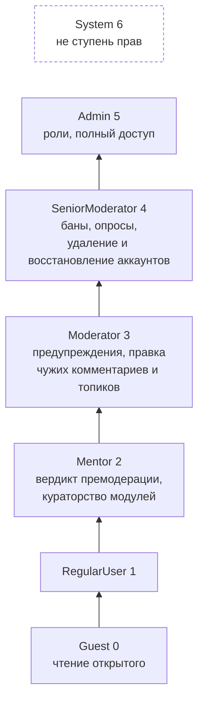

# Авторизация DM3 (RBAC)

Роли и права: кто что может на сайте и в модулях. С кодом текст не сверяется, правила держат резолверы намерений `src/DM.Domain.*/Authorization/` и их тесты в папках `Authorization` проектов `test/DM.Domain.*.Tests`, поведение через HTTP держат интеграционные тесты `test/DM.Web.API.IntegrationTests`.

---

## Роли на сайте (UserRole)

Роли сайта ранговые: `user.Role >= UserRole.Mentor` значит наставник и все выше.

**Ранг против ранга.** Действие модерации против человека (предупреждение, бан, удаление аккаунта) достает только того, кто строго ниже по роли, и никогда не администратора. Равные ранги друг друга не достают, иначе два старших модератора банили бы друг друга. Над администратором власти внутри приложения нет намеренно. Правило записано один раз (`ModerationRank.Reaches`), его спрашивают и сервис, и экран, который предлагает действие.

**Сравнивается роль, записанная на аккаунте.** От второго фактора она не зависит ни в резолверах, ни в сервисах, где роль сравнивается руками ([AUTHENTICATION.md](./AUTHENTICATION.md#второй-фактор-и-роль)). Действующие баны сворачиваются в политику доступа личности, а не в роль.

System стоит над Admin в перечислении, но это автор автоматических действий, а не уровень прав. Вход по паролю ей запрещен, выборки живых пользователей отсекают ее явным условием, иначе она попадает в рейтинги и рассылки.

---

## Специальные статусы

### Newbie (Новичок)

Новичок это флаг, а не роль: меньше 100 постов в играх (`ProbationPolicy`). Что закрыто новичку, сказано в разделе "Ограничения".

---

## Роли в модулях

Роль в модуле держится набором, а не одним значением: мастер, подписанный на свою игру, несет и Master, и Reader. Проверки спрашивают о наличии роли в наборе (`GameRoleExtensions`), а не о том, что она не ниже нужной. Ранговое сравнение есть только у ролей сайта. Порядок значений в перечислениях прав не означает.

### GameRole, роль в игре

Значения в `src/DM.Domain.Core/Enums/GameRole.cs`. Ведущие игры это мастер и ассистенты. Наставник игры курирует игру новичка, но не ведет ее, и допуск к форме настроек ведущим его не делает. `Applicant` объявлена, но ничем не назначается.

### BlogRole, роль в блоге

Значения в `src/DM.Domain.Core/Enums/BlogRole.cs`. Наставник блога допущен к оформляющемуся блогу, к блогу на премодерации и к заметкам блога. Премодерации публикаций нет: `BlogIntention.ApprovePublications` объявлено, но ни один сервис его не спрашивает.

---

## Матрицы прав

Роли сайта ранговые, поэтому в таблицах стоит младшая роль, которой действие открыто.

### Администрирование

| Действие | С какой роли |
|----------|--------------|
| Удаление чужих игр и блогов | SeniorModerator |
| Назначение модераторов раздела форума | SeniorModerator |
| Администрирование топиков: закрытие, закрепление, перенос, удаление | Admin |
| Назначение роли на сайте, в том числе наставника | Admin |

Права на форуме выдаются еще и точечно: модератор раздела администрирует топики своего раздела и правит в нем чужие топики без глобальной роли. Это единственное право модерации, которое приходит из привязки к объекту, а не из иерархии, поэтому матрица его не описывает.

### Модерация контента

| Действие | С какой роли |
|----------|--------------|
| Правка и удаление чужих комментариев | Moderator |
| Правка и удаление чужих постов в играх | Moderator |
| Правка чужих топиков | Moderator |
| Предупреждения, по рангу | Moderator |
| Наблюдение модерации: поставить и снять | Moderator |
| Удаление картинки из записи лога предупреждений, кроме записи о себе | Moderator |
| Модерация профилей | SeniorModerator |
| Удаление чужих рецензий на игры, оценок постов и рекомендаций | SeniorModerator |
| Баны, по рангу | SeniorModerator |
| Удаление и восстановление аккаунтов | SeniorModerator |
| Создание опросов | SeniorModerator |
| Шаблоны схем атрибутов | SeniorModerator |

Рецензия, оценка и рекомендация это высказанное мнение, и чужое мнение снимают ступенью выше, чем комментарий, вместе с модерацией профилей.

Картинку из записи лога о себе модератор не убирает (403, кнопки нет): сторона не разбирает свое, как в обращениях, а картинка такой записи и есть его аватар.

### Наставничество

| Действие | Кто |
|----------|-----|
| Одобрить игру или блог, из любого статуса премодерации | Mentor и выше |
| Вернуть игру или блог на правки, из любого статуса | Mentor и выше |
| Отправить свой модуль на подтверждение, только из "на правках" | мастер игры, автор блога |
| Взять модуль под кураторство и снять с себя | Mentor и выше |
| Смотреть чужие кураторства | Moderator и выше |

Вердикт это ранг и ничего больше, вне зависимости от отношения к модулю. Отправку делает только создатель, ни ассистент, ни наставник, поэтому у нее свое намерение, а не EditSettings.

Право видеть модуль на премодерации то же, что право вынести вердикт (`PremoderationAccess`), иначе очередь модерации ведет на 403 или 404. Ранг открывает только модули на премодерации, оформляющийся модуль, скрытый автором, и удаленный модуль он не открывает.

Модуль рождается "на правках", если автор новичок или под наблюдением модерации, иначе "одобрено". Наблюдение это ручной флаг пользователя, а не список нарушителей, который пересчитывается из предупреждений и банов ([GLOSSARY.md](../references/GLOSSARY.md)).

---

## Что открыто на чтение

Обсуждения игры, блога, публикации и топика читает всякий, кому видно место, гость тоже. Выключателя комментариев нет. Режим обсуждения игры решает только, кто пишет: в "Только для чтения" пишут те, у кого в игре есть роль. Черный список и бан закрывают запись, и только в своих местах. Чтение закрывают закрытая комната, неопубликованная публикация (ее видят автор и администрация) и личное: переписка, уведомления, заметки.

Модуль, который зрителю не виден (оформляющийся без открытого показа или на премодерации), не виден целиком. Все, что в нем, отвечает постороннему тем же 404 с тем же текстом, что и несуществующее. Списки, которые называют содержимое (рецензии в профиле, лента постов, поиск, таблицы лидеров, лучший пост недели), его не показывают.

---

## Права в играх

| Действие | Reader | Player | Mentor | Assistant | Master |
|----------|--------|--------|--------|-----------|--------|
| Настройки: информация игры | - | - | ✓ | ✓ | ✓ |
| Настройки: чтение списка приглашений | - | - | ✓ | ✓ | ✓ |
| Комнаты, черный список, схема атрибутов | - | - | - | ✓ | ✓ |
| Принятие персонажей, приглашение игроков, отзыв приглашения | - | - | - | ✓ | ✓ |
| Приглашение и удаление ассистентов | - | - | - | - | ✓ |
| Удаление игры | - | - | - | - | ✓ |
| Заметки игры и заметки мастера: чтение и новые записи | - | - | - | ✓ | ✓ |
| Заметки игрока: чтение и новые записи | - | ✓ | - | - | - |
| Правка чужой записи в заметках | - | - | - | - | - |
| Удаление чужой записи в заметках | - | - | - | - | ✓ |

Заявку с персонажем подает любой вошедший, пока игра идет и набор открыт или ему пришло приглашение игроком, кроме внесенного в черный список. Старшая модерация входит в `GameIntention.Edit` наравне с ведущими и удаляет игру наравне с мастером.

**Страница настроек шире правки игры.** Строки "Настройки" отвечают `GameIntention.EditSettings`, куда добавлен наставник игры, чтобы помогать новичку собрать игру. Остальное держится на `GameIntention.Edit` и намерениях приглашений, туда наставник не входит.

**Схема атрибутов принадлежит игре.** Своего намерения у нее нет, правит тот, кому открыт `GameIntention.Edit`. Цена выбора: правкой схемы старшая модерация стирает значения атрибутов у персонажей чужой игры. Шаблоны схем принадлежат сайту, игра из шаблона получает копию, и правка шаблона игр не трогает.

**Возврат персонажа.** Ведущие отменяют только свои ходы, каждый своим действием: принять отклоненную заявку (отклоненную им самим или внесением в черный список), вернуть погибшего (`Resurrect`), вернуть изгнанного (`Readmit`). Модерация в состав игры не вмешивается. Персонажа, которого игрок вывел сам, не возвращает никто.

**Комнаты.** Открытость комнаты про чтение: открытую читает всякий, кому видна игра (историю чата только вошедший), закрытую ведущие и те, кому выдан доступ, при любом статусе персонажа. Пишут в любой комнате ведущие и те, у кого доступ "Может писать" (`Full`), через персонажа только пока он в игре. Администратор без доступа тоже не пишет. Невидимую комнату фильтр `RoomAvailable` отсеивает до резолвера, поэтому ее чат отвечает 404, а не 403.

**Три блокнота игры.** Заметки игрока ведет владелец персонажа для себя, и мастеру они закрыты. Заметки игры и заметки мастера (они есть у каждого персонажа) открыты ведущим, игроку нет. Наставник игры не входит ни в один.

**Записи блокнота.** Доступ дает роль, право на запись авторство. Правит только автор, иначе чужая правка стояла бы под его именем. Удаляют автор и мастер, который отвечает за блокноты игры.

---

## Видимость privacy-тегов BBCode

Кто видит `[private]` и почему `[mod]` открыт всем, записано в [BBCODE_RENDERING.md](BBCODE_RENDERING.md#матрица-видимости-privacy-тегов). Отсюда туда приходит только понятие ведущих игры (раздел "Права в играх"): приватный текст в игре видят мастер и ассистенты, наставник нет, модерация тоже нет.

---

## Баны

Видов бана ровно два, они различаются охватом. Любое иное значение при выдаче сводится к полному бану, чтобы искаженный запрос не выдал бан слабее безопасного.

**Кто выдает.** Старший модератор, по рангу ("Ранг против ранга"). Исключение автобан (`WarningPolicy`): когда сумма активных баллов предупреждений пересекает порог, сайт сам выдает короткий демократический бан от системного аккаунта, не поверх идущего. Полным он не бывает: по арифметике сайт не закрывают, срок автобана нужен, чтобы человек посмотрел на случай.

**Кто снимает.** Старший модератор и выше, по одному правилу (`BanService.LiftRefusal`), которое и отказывает, и ставит `canLift` в ответах API. Снятый бан отвечает 404, закончившийся 409, свой 403 (демократический бан оставляет роль и вход, иначе старший модератор снимал бы его с себя). Постоянный снимает только администратор, добровольный постоянным не считается.

**История банов.** Читается событиями (выдача, снятие) от нового к старому, при равном времени снятие раньше выдачи. Причина бана с разметкой, причина снятия простым текстом.

### Демократический бан, основной

Глушит публичную речь, свое остается открытым. Читать сайт можно целиком.

| Поверхность | Под демократическим баном |
|-------------|---------------------------|
| Глобальный чат | Запрещено |
| Создание топика на форуме | Запрещено |
| Комментарии в топиках форума | Запрещено |
| Обсуждение чужой игры | Запрещено |
| Обсуждение своей игры (мастер, ассистент, наставник или принятый игрок) | Разрешено |
| Обсуждение чужого блога и публикаций чужого блога | Запрещено |
| Обсуждение своего блога (автор, ассистент или наставник) | Разрешено |
| Посты и сообщения в игровых комнатах | Не затронуто, работает по доступу к комнате |
| Публикации блога | Не затронуто |
| Личные сообщения | Не затронуто |

Заявка и подписка своим модуль не делают. Роли своего перечисляются поименно, а не "все, кроме читателя", иначе новая роль расширит исключение сама.

Оценки постов, рекомендации, рецензии на игры и отзывы о сайте под бан не попадают: бан снимает голос в обсуждениях, а не право оценивать.

### Полный бан, редкий

Запрещает отправлять что угодно, своя игра тоже закрыта. Кроме того, он отвергает аутентификацию: вход не выполняется, выданная кука перестает действовать на следующем запросе. Адресат обычно бот, для человека есть демократический.

### Где проверяется

Правило записано один раз (`AccessRestrictions`) и вызывается из резолверов. В сервис проверка переезжает, где резолверу не передают владельца поверхности: обсуждение публикаций и правка комментариев (раздел "Где живет проверка").

Правка своего комментария или топика подчиняется тому же правилу, что и создание. Модераторская правка чужого под бан не попадает, бан не отнимает инструментов модератора.

Свой топик автор закрывает и открывает, это тоже речь. Закрытый модератором раздела или администратором он не правит и не открывает, иначе закрытие снималось бы одной галочкой.

---

## Обращения

Обращение читает его автор и модератор, которому оно по делу. Правило модератора одно на все пути к обращению (`TicketVisibility`) и состоит из двух половин: причина открыта его роли: модератору жалобы на пользователей и предложения, старшему модератору еще жалобы на решения модератора, администратору все, включая поддержку, и он не нарушитель, которого обращение называет. Жалоба на себя для модератора неотличима от несуществующей. Всем остальным обращение отвечает 404. Гость читает и пишет только свое обращение по токену в заголовке `X-Dm-Ticket-Token` ([API_DESIGN.md](../conventions/API_DESIGN.md)), и его комментарий всегда гостевой, кто бы ни был вошедшим.

Назначения нет, очередь одна. Пишут автор и такие модераторы, пока обращение открыто и в нем меньше ста ответов (`canComment`). Ответ автора ставит "Ожидает ответа модерации", статус автор не выбирает (403), даже если он модератор. Модератор не автор (`canResolve`) выбирает статус вместе с ответом. Текст и статус пишутся одной условной записью, поэтому из двух одновременных закрытий второе получает отказ. Предупреждения и баны выдаются из профиля, а не из обращения.

## Черные списки

Черный список закрывает минимум. Кто пишет в комнатах, решают комнаты и состав игры. Рецензия, оценка поста и лайк это отзыв, за разборки в них отвечает модерация. Читать и подписываться может каждый: прятать публичный модуль от одного человека значило бы обещать приватность, которой нет.

| Список | Что закрывает | Кто ведет |
|--------|---------------|-----------|
| Черный список игры | комментарии в обсуждении игры и заявки, вместе с правкой своего | ведущие игры и старшая модерация (`GameIntention.Edit`) |
| Черный список блога | комментарии в обсуждении блога и под его публикациями, вместе с правкой своего | автор блога и администрация (`BlogIntention.Edit`) |

Остальное внесенному открыто: посты и их правка, чат-комната, "ждем пост", рецензия, оценка поста, лайки, удаление своего.

Правило записано один раз для каждого модуля, предикатом `IsBlacklisted` рядом с ролями, отказ с причиной дает только соседний `ThrowIfBlacklisted`. Резолвер спрашивает предикат, чтобы `IsAllowed` не обещал того, в чем откажет сервис, а сервис спрашивает `ThrowIfBlacklisted` первым, чтобы человек прочитал причину. Кому можно спрашивать список, перечислено в гейте [BlacklistRuleShould.cs](../../test/DM.Architecture.Tests/BlacklistRuleShould.cs): новый запрет это решение, а не строка в сервисе.

Экран не предлагает закрытого по `viewer.canComment` (раздел "Признаки зрителя") и `viewerBlacklisted` у деталей игры и блога.

Внести в список нельзя мастера и наставника игры, автора и наставника блога. Ассистента и принятого игрока сначала убирают из состава: список для тех, кто снаружи. Внесение отменяет ожидающие приглашения и отклоняет заявки на рассмотрении. Пригласить внесенного ведущий может, но заявку список закрывает и приглашенному.

Личный черный список (A внес X) устроен иначе. С переключателем "Не принимать от них личные сообщения" он закрывает X личку A, включая группу вдвоем и добавление A в группу, и `viewer.canMessage` и `viewer.canWrite` говорят то же, что сказал бы отказ. Приглашение от X до A не доходит, без имени и причины в отказе. Уведомлений о действиях X A не получает. Переключатели "Скрывать их комментарии", "Скрывать их сообщения в общем чате", "Скрывать их игры" и "Скрывать их блоги" меняют только то, что видит A (игры и блоги X уходят из каталогов, сайдбаров и поиска, но не из своих игр A и не из списка, запрошенного по имени X), а "Переносить список в мои новые игры и блоги" копирует список в новый модуль. Свой список владельца не ограничивает.

Топики и общий чат публичны: личный список их не закрывает, запрет на запись в них делается баном.

---

## Права в блогах

| Действие | Reader | Mentor | Assistant | Author |
|----------|--------|--------|-----------|--------|
| Создание публикаций | - | - | ✓ | ✓ |
| Создание рубрик | - | - | - | ✓ |
| Настройки: информация блога | - | - | ✓ | ✓ |
| Настройки: чтение списка приглашений | - | - | ✓ | ✓ |
| Приглашение читателей | - | - | ✓ | ✓ |
| Отзыв приглашения, приглашение и удаление ассистентов | - | - | - | ✓ |
| Управление черным списком | - | - | - | ✓ |
| Удаление блога | - | - | - | ✓ |
| Заметки блога: чтение и новые записи | - | ✓ | ✓ | ✓ |
| Правка чужой записи в заметках | - | - | - | - |
| Удаление чужой записи в заметках | - | - | - | ✓ |

Публикацию правит, публикует и удаляет ее автор или администратор, автор блога чужую не правит. Записи заметок блога живут по правилу игры. Комментировать опубликованное может любой вошедший, кроме внесенных в черный список блога и тех, кому это закрывает бан.

**Страница настроек шире правки блога.** Строки "Настройки" отвечают `BlogIntention.EditSettings`, она же пускает на страницу. Остальное держится на `BlogIntention.Edit` и намерениях приглашений и рубрик, туда ассистент не входит. Наставник блога в настройки не входит, в отличие от наставника игры.

**Старшая модерация получает настройки и удаление блога, но не черный список.** `EditSettings` и удаление открыты с `SeniorModerator`, а `Edit` (черный список, включая чтение, и удаление ассистентов) требует `Admin`. В играх старшая модерация держит и черный список. Интерфейс повторяет сервер: секции черного списка на странице нет, ранги в отказах не упоминаются.

---

## Права на форуме

### BoardAccessPolicy (битовая маска)

Раздел форума хранит две маски `BoardAccessPolicy` (`src/DM.Domain.Core/Enums/BoardAccessPolicy.cs`): `ViewPolicy`, кто видит раздел, и `CreateTopicPolicy`, кто создает в нем топики. Роль читающего переводится в бит в `AccessPolicyConverter`, и пересечение масок решает.

---

## Intention Pattern

По умолчанию права проверяются намерениями: сервис зовет `IIntentionManager.ThrowIfForbidden(намерение)` или `ThrowIfForbidden(намерение, цель)`, а ответ дает резолвер модуля в его папке `Authorization/`.

### Где живет проверка

По умолчанию в резолвере. Исключений два, и оба перечислены здесь.

Владелец поверхности: ответ зависит от того, чья игра или блог, а владельца резолверу не передают (раздел "Баны", "Где проверяется").

Модерация: основание в тексте отказа. Отказ по намерению звучит одной фразой на весь сайт, чтобы не рассказывать спрашивающему про объекты, которых он не видит. Модерации нужен адресный отказ: ее экраны собраны из соседних действий с разными порогами (предупреждение, бан, снятие постоянного бана, бан из обращения, кураторство), и модератору надо знать, какой роли не хватило. Поэтому там роль сравнивается в доменном сервисе, и все проверки одной поверхности говорят одним способом.

Границы исключения:

- Оно действует только в модерации. Другой модуль требует отдельного решения, записанного здесь.
- Обратного хода нет: где проверка идет через намерение, она там и остается.
- Двух копий правила быть не должно: намерение для действия, роль на которое сравнивает сервис, это вторая копия порога, которая молча разойдется с настоящей проверкой.
- Сравнение двух ролей ("Ранг против ранга") остается в сервисе всегда: отказ обязан сказать, чем именно цель не подошла.

### Признаки зрителя

Ответ о записи несет объект `viewer`: что этому зрителю с ней можно. Страница предлагает действие по признаку и сама ничего не считает. Это `canComment` у деталей игры, блога, публикации и топика, `canReview` у деталей игры и у каждого поста, `canCreateTopic` у раздела форума (с `canCreateTopicAfterSignIn` для гостя), `canWrite`, `canLeave` и `canClearHistory` у переписки и общего чата, `canMessage` у профиля.

Признак спрашивается тем же кодом, которым откажет запись: у комментариев `MayCreate` рядом с `CreateAsync`, у оценки поста один `JudgeAsync`, у переписки те же помощники `MessageService` и те же намерения. Новичку признак оценки не мешает, он сужает знак до "=". Признак есть в ответе об одной записи и в ответах на запись, в списках его нет. Он относится к тому, кто держал сессию при чтении, поэтому при смене зрителя запись читается заново.

Чат-комната игры признака не несет, и это известное отступление: `GameChatRoom.vue` повторяет правило `SendMessage` по строкам доступа и ролям. Меняя правило записи в чат, менять его в двух местах, пока у комнаты не появится `viewer.canWrite`.

---

## Ограничения

### Для новичков (< 100 постов)

| Ограничение | Описание |
|-------------|----------|
| Игра и блог | Создаются на премодерации, выпускает наставник сайта и выше |
| Рекомендации | Запрещены |
| Рецензии на игры | Запрещены |
| Оценки постов | Только нейтральные, правкой знак тоже не поднять |

### Временные лимиты

| Ограничение | Значение |
|-------------|----------|
| Правка своей рецензии на игру и рекомендации | сутки с создания |
| Правка своей оценки поста | 15 минут с публикации |
| Следующая оценка поста в той же игре | через 3 дня после предыдущей |
| Правка и удаление своего сообщения | 15 минут (`MessagingConfiguration`), модератору без срока |
| Правка своего поста и комментария | 15 минут только на клиенте, сервер срока не ставит |

Администратор правит свою рецензию, оценку и рекомендацию без срока. Удаление своей рецензии, оценки, рекомендации, поста и комментария срока не имеет.
