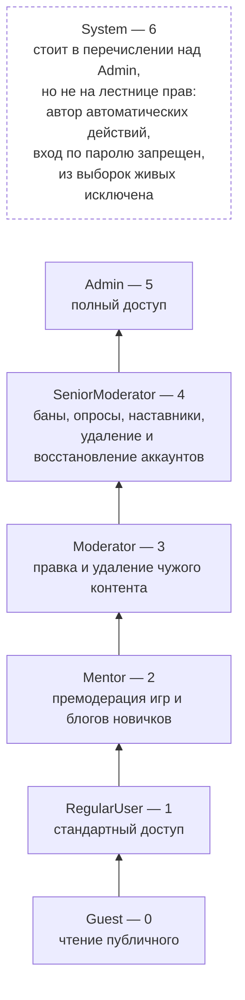
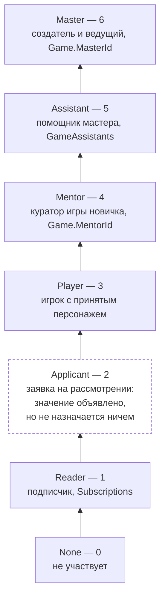
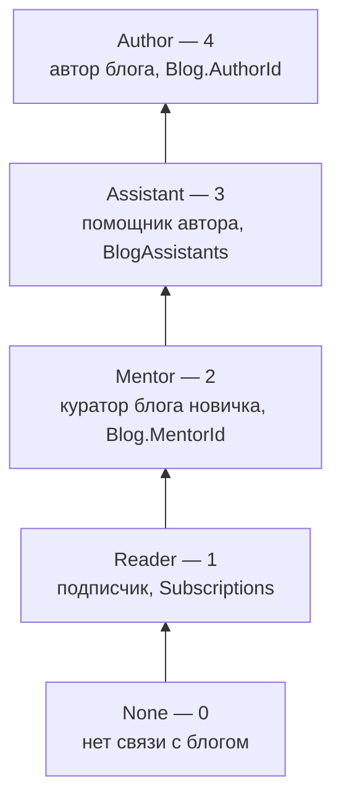

# Авторизация DM3 (RBAC)

> **User Story:** "Какие роли? Кто что может? Как работают права?"

> **Код:** `src/DM.Domain.*/Authorization/`

---

## Роли на сайте (UserRole)

Глобальная иерархия ролей пользователя на сайте:



**Правило:** `user.Role >= UserRole.Mentor` означает Mentor и все выше.

**Ранг против ранга.** Действие модерации против человека достает только того,
кто строго ниже по роли, и никогда не администратора: это предупреждение, бан и
удаление аккаунта модерацией. Модератор предупреждает пользователя и
наставника, но не другого модератора, старшего модератора и администратора.
Старший модератор достает модератора и всех ниже, но не другого старшего
модератора. Администратор достает всех, кроме администраторов. Равные ранги друг
друга не достают: иначе два старших модератора банили бы друг друга, а
предупреждение снизу ничего не весит, потому что старший модератор сам снимает
баллы с любого предупреждения, выданного ему. Над администратором власти внутри
приложения нет намеренно. Правило записано один раз (`ModerationRank.Reaches`
в Domain.Core) и спрашивается и сервисом, который отказывает, и экраном,
который предлагает действие: кнопки "Выдать предупреждение" и "Выдать бан" на
профиле приходят флагами с сервера, пункт "Предупреждение" под текстом
считается клиентом из двух ролей, которые страница уже знает (читателя и
автора), той же формулой. Чего нельзя, того нет на экране, а сервер отказывает
все равно.

**Сравнивается роль, записанная на аккаунте, и от двухфакторной аутентификации она
не зависит.** Старший модератор и администратор без второго фактора сравниваются
по своей роли везде разом: и в резолверах намерений, и в тех доменных сервисах, где
роль сравнивается руками. Включенный второй фактор требуется при входе от учетки
любой роли одинаково, а на сравнение полномочий после входа не влияет
([AUTHENTICATION.md](./AUTHENTICATION.md#второй-фактор-и-роль)). При построении
личности в нее сворачиваются только действующие баны, и сворачиваются они в
политику доступа, а не в роль.

Над Admin в перечислении стоит служебная роль System. Это не уровень привилегий, а
автор автоматических действий: системные письма, служебные обращения, записи о том,
что сделано без человека. Отсюда два требования, которые из описанной выше механики
сравнений не следуют. Вход по паролю такой роли запрещен, и отказ выносится по роли
до сравнения пароля. Выборки живых пользователей отсекают ее явным условием, иначе
она попадает в рейтинги, рассылки и адресаты уведомлений.

---

## Специальные статусы

### Newbie (Новичок)

| Условие | `QuantityRating < 100` (менее 100 постов) |
|---------|-------------------------------------------|
| **Ограничения** | Премодерация игр/блогов, ограничения на ревью |

---

## Роли в модулях

Стрелка на двух схемах ниже показывает порядок значений в перечислении, а не
вложенность прав. Роль в модуле держится набором, а не одним значением: мастер,
подписанный на собственную игру, несет и Master, и Reader. Проверки спрашивают о
наличии роли в наборе (`GameRoleExtensions`), а не о том, что она не ниже
нужной. Ранговое сравнение `>=` есть только у ролей сайта выше.

### GameRole — Роль в игре



### BlogRole — Роль в блоге



---

## Матрицы прав

### Администрирование

| Действие | User | Mentor | Mod | SeniorMod | Admin |
|----------|------|--------|-----|-----------|-------|
| Администрирование форумов | - | - | - | - | ✓ |
| Удаление игр/блогов (не своих) | - | - | - | ✓ | ✓ |

Матрица описывает глобальные роли. Права на форуме выдаются еще и точечно:
назначенный модератор раздела получает администрирование топиков этого раздела и правку
чужих топиков в нем, не имея глобальной роли. Это единственное место, где право на
модерацию приходит не из глобальной иерархии, а из привязки к объекту, и матрицей
оно не описывается принципиально.

### Модерация контента

| Действие | User | Mentor | Mod | SeniorMod | Admin |
|----------|------|--------|-----|-----------|-------|
| Редактирование/удаление топиков форума | - | - | ✓ | ✓ | ✓ |
| Редактирование/удаление комментариев | - | - | ✓ | ✓ | ✓ |
| Модерация профилей | - | - | - | ✓ | ✓ |
| Удаление картинки из записи лога за профиль, кроме записи о себе | - | - | ✓ | ✓ | ✓ |
| Удаление ревью | - | - | - | ✓ | ✓ |
| Создание опросов | - | - | - | ✓ | ✓ |
| Шаблоны схем атрибутов | - | - | - | ✓ | ✓ |
| Назначение наставников | - | - | - | ✓ | ✓ |

Картинку из записи лога за профиль модератор убирает только у записи о другом
человеке. Предупреждение, выданное ему самому (до повышения или старшим по рангу),
разбирает другой модератор: сторона не разбирает свое, как у обращений. Своей записи
сервер отвечает 403 и ничего не помечает, и кнопки у такой записи в модераторском
логе нет. Картинка
этой записи и есть его аватар: удаление от его имени лог и сборщик загрузок читают
как действие владельца, так что картинка осталась бы в логе, а нынешний аватар ушел
бы из профиля.

### Наставничество

У премодерации ровно три перехода, и актер у них не общий.

| Действие | User | Автор модуля | Mentor | Mod | SeniorMod | Admin |
|----------|------|--------------|--------|-----|-----------|-------|
| Одобрить игру/блог (из любого статуса) | - | - | ✓ | ✓ | ✓ | ✓ |
| Вернуть игру/блог на правки (из любого статуса) | - | - | ✓ | ✓ | ✓ | ✓ |
| Отправить свой модуль на подтверждение (только из "на правках") | - | ✓ | - | - | - | - |

Два первых перехода — ранг и ничего больше: наставник и все выше него в
модерации, вне зависимости от отношения к модулю. Третий — только создатель
(мастер игры, владелец блога); ни ассистент, ни куратор, ни старшая модерация
его не делают, поэтому у него отдельное намерение, а не EditSettings.

Право видеть премодерируемый модуль — то же самое право, что и право вынести по
нему вердикт, а не отдельный список ролей. Иначе очередь модерации ведет на 403
или 404: у модуля "на правках" куратор не записан вовсе, так что арка "назначен
куратором" тут никого не пускает. Ранг открывает ровно модули на премодерации:
черновик спрятан выбором автора, а не премодерацией, и рангом не открывается;
удаленный модуль не открывается ничем.

Статус, в котором модуль создается, решается по автору: новичок или пользователь
под наблюдением модерации получает "на правках", остальные — "одобрено".
Наблюдение — ручной флаг пользователя, его ставит и снимает Moderator и выше;
это не список нарушителей, который пересчитывается из активных предупреждений и
банов и гаснет вместе с ними ([GLOSSARY.md](../references/GLOSSARY.md)).

---

## Что открыто на чтение

Обсуждения игры, блога, публикации и топика читает всякий, кому видно место, гость
тоже. Выключателя комментариев нет. Режим обсуждения игры решает только, кто
пишет: в "Только для чтения" пишут те, у кого в игре есть роль. Черный список и бан
закрывают запись, и только в своих местах. Чтение закрывают закрытая комната,
неопубликованная публикация (ее видят автор и администрация) и личное: переписка,
уведомления, заметочники.

Модуль, который зрителю не виден (оформляющийся без открытого показа или на
премодерации), не виден целиком. Все, что в нем, отвечает постороннему так же, как
то, чего нет: тем же 404 с тем же текстом. Списки, которые называют содержимое
(рецензии в профиле, лента постов, поиск, таблицы лидеров, лучший пост недели), его
не показывают. Поведение держат интеграционные `DiscussionReadingShould` и
`HiddenModuleShould`.

---

## Права в играх

| Действие | Reader | Player | Mentor | Assistant | Master |
|----------|--------|--------|--------|-----------|--------|
| Просмотр открытого контента | ✓ | ✓ | ✓ | ✓ | ✓ |
| Создание персонажа | - | ✓ | - | - | ✓ |
| Настройки: информация игры | - | - | ✓ | ✓ | ✓ |
| Настройки: чтение списка приглашений | - | - | ✓ | ✓ | ✓ |
| Создание/удаление комнат | - | - | - | ✓ | ✓ |
| Черный список игры | - | - | - | ✓ | ✓ |
| Схема атрибутов игры | - | - | - | ✓ | ✓ |
| Принятие персонажей | - | - | - | ✓ | ✓ |
| Приглашение игроков | - | - | - | ✓ | ✓ |
| Отзыв приглашения | - | - | - | ✓ | ✓ |
| Приглашение ассистентов | - | - | - | - | ✓ |
| Удаление ассистентов | - | - | - | - | ✓ |
| Удаление игры | - | - | - | - | ✓ |
| Заметки игры: чтение и создание записей | - | - | - | ✓ | ✓ |
| Заметки игрока: чтение и создание записей | - | ✓ | - | - | - |
| Заметки мастера о персонаже: чтение и создание записей | - | - | - | ✓ | ✓ |
| Правка чужой записи в заметках | - | - | - | - | - |
| Удаление чужой записи в заметках | - | - | - | - | ✓ |

**Возврат персонажа в игру.** Ведущий отменяет только свои ходы: принимает заявку, которую отклонили (им самим или внесением в черный список), возвращает в игру персонажа, которого отметил погибшим (`Resurrect`), и персонажа, которого изгнал (`Readmit`). Каждый возврат отменяет только свой ход: погибшего не возвращают как изгнанного, изгнанного не воскрешают. Возвращают мастер и ассистенты, те же, кто изгоняет; игрок изгнанного персонажа себя не возвращает, модерация в состав игры не вмешивается. Персонажа, которого игрок вывел из игры сам, не возвращает никто: ни игрок, ни ведущий, ни модерация, даже если ведущий успел отметить его погибшим или изгнанным. Писать в комнатах может только персонаж в игре: строки доступа выбывшего персонажа остаются у комнаты и ничего не открывают.

**Открытость комнаты про чтение.** Открытую комнату, ее посты и ее чат читает всякий, кому видна игра; историю чата только вошедший, чтение сообщений требует входа. Закрытую читают мастер и ассистенты и те, кому в ней выдан доступ, читателю или его персонажу, при любой политике доступа и при любом статусе персонажа. Пишут в любой комнате, открытой тоже, мастер и ассистенты, а кроме них только тот, кому выдан доступ "Может писать" (`Full`): пост от лица своего персонажа, сообщение чата от себя как читатель или через своего персонажа, и персонаж только пока он в игре. Тип комнаты на запись не влияет: без доступа в открытой комнате не пишет никто, кроме ведущих, админ тоже. Доступ в открытой комнате выдается так же, как в закрытой. Чат решает `RoomIntentionResolver` (`ViewMessages`, `SendMessage`), а комнату невидимой игры и закрытую без доступа еще до него отсеивает фильтр чтения комнаты `RoomAvailable`: на такую комнату чат отвечает 404, а не 403.

**Три заметочника игры.** "Заметки игры" принадлежат игре и открыты ее ведущим. "Заметки игрока" принадлежат персонажу, их ведет владелец персонажа, и это единственный заметочник игры, который не открывается мастеру: игрок пишет их для себя, и доступный мастеру он был бы не тем, что обещан. "Заметки мастера" принадлежат тому же персонажу и открыты ведущим, а игроку — нет; они есть у каждого персонажа, не только у NPC. Наставник не входит ни в один из трех: курировать игру — не вести ее.

**Записи заметочника.** Доступ в заметочник дает роль, право на отдельную запись — авторство. Правит запись только тот, кто ее написал: переписанная чужой рукой, она осталась бы стоять под его именем. Удаляют автор и мастер игры, который отвечает за содержимое заметочников своей игры. Отсюда единственное расхождение мастера и ассистента не в пользу второго: заметки игры открыты ассистенту целиком, но чужую запись из них убирает только мастер, свою — каждый. В заметки игрока мастер не попадает вовсе, поэтому и удалять там ему нечего.

**Страница настроек шире правки игры.** Две первые строки таблицы отвечают отдельной интенции `GameIntention.EditSettings`, куда добавлен приставленный к игре наставник: он помогает новичку собрать игру, поэтому форма информации и список приглашений ему открыты. Все остальное в таблице держится на `GameIntention.Edit` и на собственных интенциях приглашений, и туда наставник не входит: комнаты, черный список, состав игры и отзыв приглашений остаются за ведущими. Чтение списка приглашений и право приглашать расходятся намеренно.

**Схема атрибутов принадлежит игре, а не автору.** У каждой игры своя строка схемы, и правит ее тот, кому открыт `GameIntention.Edit`, то есть мастер, ассистенты и старшая модерация, ровно как комнаты и черный список. Своего намерения у схемы нет намеренно: оно стоило бы ветки резолвера и строки в таблице ради вычитания старшего модератора, который и так удаляет чужие игры целиком. Наставник в правку не входит, хотя страница настроек ему открыта: курировать игру не значит вести ее. Цена этого выбора названа прямо: правкой схемы старшая модерация стирает значения атрибутов у персонажей чужой игры. Шаблоны схем принадлежат сайту: читают их все, включая гостя, а заводит, правит, удаляет и назначает шаблоном по умолчанию старшая модерация (`AttributeSchemaTemplateIntention.Manage`). Игра, созданная из шаблона, дальше живет сама: копия делается по значению, и правка шаблона ни одну игру не трогает.

**Ведущие игры = Master + Assistant.** Наставник (`GameRole.Mentor`) **не** является ведущим: он курирует игру новичка, но не ведет ее. Допуск к форме настроек ведущим его не делает. Это правило используется в render-контракте `[private]`: только master и assistants видят все приватные блоки в игре автоматически (lead-override), наставник нет.

---

## Видимость privacy-тегов BBCode

`[private]` — privacy-sensitive BBCode-тег, видимость которого определяется правами зрителя и контекстом контента. Фильтрация происходит на сервере **до сериализации JSON**: отфильтрованный контент никогда не попадает на клиент к неавторизованному зрителю.

**`[mod]`** — **публичный на чтение**: рендерится одинаково для всех зрителей, включая гостей. Ограничение у него на запись — неавторизованная разметка разворачивается при сохранении. Читательской фильтрации по роли у `[mod]` нет, и это намеренно: речь модерации адресована всем. SSOT — [BBCODE_RENDERING.md](BBCODE_RENDERING.md).

**`[private]`** — валиден только в GamePost. Виден если выполнено ЛЮБОЕ из:
- зритель = автор поста (author-forever, snapshot);
- зритель — владелец одного из персонажей-адресатов (addressee-forever, per-block snapshot);
- зритель — ведущий игры (master или assistant; наставник исключен);
- у поста включен `SharePrivateWithAll` (per-post override, внутри множества читателей комнаты);
- у комнаты включен `ViewPrivateText` (per-room override, внутри множества читателей комнаты).

Два последних условия открывают только блок с адресатами. `[private]` без имени и всякое битое написание блока видят автор поста и ведущие игры, и никто больше: адресата у такого блока нет, и настройки поста и комнаты его не открывают. Что считается битым написанием, сказано в [BBCODE_RENDERING.md](BBCODE_RENDERING.md#скрытый-блок-private).

Moderator+ **не** видит `[private]` — нет backdoor'а для аудита. Полный контракт — в [BBCODE_RENDERING.md](BBCODE_RENDERING.md).

---

## Баны

Существует ровно два вида бана, и они различаются охватом. Третьего нет: любое иное значение при выдаче сводится к полному бану, чтобы искаженный запрос не выдал бан слабее безопасного.

**Кто выдает.** Бан выносит старший модератор, и только тому, кто ниже его по рангу ("Ранг против ранга" выше). Единственное исключение — автобан: когда сумма активных баллов предупреждений доходит до порога, сайт сам выдает демократический бан на 48 часов от системного аккаунта. Порог и срок лежат в `WarningPolicy`, охват всегда демократический: полный бан отвергает вход, а закрывать сайт по арифметике, до того как на случай посмотрел человек, автобан не должен. Он срабатывает на пересечении порога, а не на стоянии над ним, и никогда не накладывается поверх уже идущего бана. Решает не он: 48 часов — это время, за которое старший модератор или администратор снимает его или выносит свой бан.

**Кто снимает.** Снять бан может старший модератор и выше, по одному правилу, которое и отказывает на снятии, и ставит признак "можно снять" (`canLift`) у каждого бана в ответах API, чтобы список не предлагал того, от чего запись откажет (`BanService.LiftRefusal`). Снятый бан снять нельзя, его нет (404). Закончившийся тоже нельзя (409): от него нечего заканчивать, а снятие после конца стояло бы в списке записью о бане, который уже кончился. Свой бан не снимает никто (403): демократический бан оставляет роль модератора и вход, и иначе забаненный старший модератор снимал бы его с себя сам. Постоянный бан снимает только администратор, добровольный бан постоянным не считается.

**История банов.** История читается событиями, а не банами: выдача по дате начала и снятие по дате снятия, от нового к старому, при равном времени снятие раньше выдачи. Каждое событие несет бан целиком, вместе с охватом и тем, кто снял. Причина бана с разметкой (`CommonBbText`), причина снятия простым текстом.

### Демократический бан — основной

Глушит **публичную речь**, оставляя открытым все свое. Пользователь продолжает читать сайт целиком.

| Поверхность | Под демократическим баном |
|-------------|---------------------------|
| Глобальный чат | Запрещено |
| Создание топика на форуме | Запрещено |
| Комментарии в топиках форума | Запрещено |
| Обсуждение **чужой** игры | Запрещено |
| Обсуждение **своей** игры (мастер, ассистент, наставник или принятый игрок) | Разрешено |
| Обсуждение **чужого** блога и публикаций чужого блога | Запрещено |
| Обсуждение **своего** блога (автор, ассистент или наставник) | Разрешено |
| Посты и сообщения в игровых комнатах | Не затронуто, работает по доступу к комнате |
| Публикации блога | Не затронуто |
| Личные сообщения | Не затронуто |

**Что значит "свое".** Игра — участие в ней или кураторство над ней: мастер, ассистент, наставник или игрок с **принятым** персонажем. Поданная заявка участником не делает: пока персонаж на рассмотрении, в обсуждении писать нельзя. Блог — авторство, ассистентство или кураторство. Подписка своим модуль не делает — ни игру, ни блог: читать не то же самое, что принадлежать. Наставник считается: его приставляют к модулю новичка ровно для того, чтобы он в нем говорил, и молчащий наставник бесполезен. Роли перечисляются поименно, а не как "все, кроме читателя", иначе новая роль расширяет исключение из бана сама собой.

**Что демократический бан не трогает намеренно.** Оценки постов, рекомендации на профилях, рецензии на игры и отзывы о сайте под него не попадают. Это осознанное решение: бан снимает голос в общих обсуждениях, а не право оценивать.

### Полный бан — редкий

Запрещает отправлять что угодно. Владение поверхностью его не ослабляет: своя игра под полным баном тоже закрыта. Помимо этого полный бан отвергает саму аутентификацию — вход не выполняется, а выданная ранее кука перестает действовать на следующем же запросе, не дожидаясь истечения сессии. Типичный адресат — бот, а не живой нарушитель: для человека применяется демократический.

### Где проверяется

Правило вычисляется в одном месте (`Domain.Core/Authorization`) и вызывается из резолверов намерений тех поверхностей, которых оно касается. Проверка переезжает в сервис там, где ответ зависит от владельца поверхности, а резолверу владельца не передают: так устроены обсуждение публикаций и правка комментариев, где цель резолвера — сам комментарий, а не игра или блог под ним. Само правило при этом не дублируется. Это первое из двух исключений из порядка, по которому проверка живет в резолвере. Второе, модерационное, описано в разделе про паттерн Intention.

Правка подчиняется тому же правилу, что и создание: переписать свой комментарий или свой топик значит выпустить тот же публичный текст. Спрашивают при этом только автора. Модераторская правка чужого текста под правило не попадает: бан не снимает модераторских полномочий, поэтому закрытие, прикрепление и перенос топика забаненному модератору раздела остаются. Свой топик закрывает и открывает и автор, и для него это такая же правка, как текст: демократический бан отнимает и то и другое. Топик, закрытый модератором раздела или администратором, автор не правит. Закрытый им самим правит, как открытый: иначе сохранение формы с оставленной галочкой упиралось бы в отказ. Открытие приходит вместе с текстом формы и принимается целиком. Открыть автор может только топик, который закрыл сам: закрытие модератором раздела или администратором держится, иначе его снимали бы одной галочкой. Топик помнит, закрыл ли его автор, и отдает этот признак клиенту, чтобы тот не предлагал автору открыть чужое закрытие.

---

## Обращения

Обращение читает его автор, какой бы ни была его роль, и модератор, которому
обращение по делу. Правило модератора одно на все пути к обращению (`TicketVisibility`:
страница, ответ, очередь со счетчиками, уведомления) и состоит из двух половин.
Причина открыта роли: младшему модератору жалобы на пользователей и предложения,
старшему вдобавок жалобы на решение младшего, администратору все, а причины
поддержки только администратору. И читающий не нарушитель, которого обращение
называет: для жалобы на себя модератор обычный пользователь, она неотличима от
несуществующей (404 на чтение и на ответ), в очереди и счетчиках ее
нет, уведомления о ней он не получает. Всем остальным обращение тоже отвечает 404.
Гость читает и пишет только свое обращение и только по токену в заголовке
(`X-Dm-Ticket-Token`, [API_DESIGN.md](../conventions/API_DESIGN.md)), и его
комментарий всегда гостевой, кто бы ни был вошедшим.

Назначения нет: обращение не берут в работу, отвечает и закрывает любой модератор,
которому оно по делу, и очередь у модерации одна, все обращения, которые роль читает.
Отвечать в переписке могут автор и такие модераторы, пока обращение открыто и в
переписке меньше ста ответов (признак `canComment`). Ответ передает ход. Ответ автора
ставит "Ожидает ответа модерации", статуса он не выбирает: присланный статус получает
403, даже если автор модератор. Модератор, которому обращение по делу и который не
его автор (признак `canResolve`), выбирает статус вместе с ответом: "Ожидает ответа
пользователя" по умолчанию, "Закрыто" или "Спам". Для первого нужен текст, для двух
других текст можно не писать, тогда ответ только меняет статус. Текст и статус
пишутся одной условной записью открытого обращения, поэтому из двух закрытий,
пришедших вместе, второе получает отказ. Предупреждений и банов в обращении нет:
их выдают из профиля нарушителя.

## Черные списки

Черный список закрывает минимум и не делает работу других инструментов. Кто пишет в комнатах, решают комнаты и состав игры. Рецензия, оценка поста и лайк это отзыв, и за отзыв, превращенный в разборки, отвечает модерация, а не список. Читать и подписываться может каждый: игра и блог публичны для всех остальных, и прятать их от одного человека значило бы обещать приватность, которой нет.

| Список | Что закрывает | Кто ведет |
|--------|---------------|-----------|
| Черный список игры | комментарии в обсуждении игры и заявки, в обоих случаях вместе с правкой своего | ведущие игры и старшая модерация (`GameIntention.Edit`) |
| Черный список блога | комментарии в обсуждении блога и под его публикациями, вместе с правкой своего | автор блога и администрация (`BlogIntention.Edit`) |

Остальное внесенному открыто, как всем: посты и их правка, чат-комната, "ждем пост", рецензия на игру, оценка поста, лайки, удаление своего.

Отказ звучит одинаково: "Вы в черном списке этой игры" или "Вы в черном списке этого блога". Правило записано один раз для каждого модуля, предикатом `IsBlacklisted` рядом с ролями игры и блога, и отказ с этим текстом дает только соседний `ThrowIfBlacklisted`. Резолвер спрашивает предикат в `CreateComment` и `CreateCharacter`, чтобы `IsAllowed` не отвечал "можно" тому, кому сервис потом откажет, а сервис спрашивает `ThrowIfBlacklisted` до общей проверки, чтобы человек прочитал причину. Кому можно спрашивать список, перечислено в архитектурном гейте `BlacklistRuleShould`: новый запрет это решение, а не строка в сервисе. Поведение по действиям держит интеграционный `BlacklistRuleShould`. Правка своего комментария найдет комментарий только своего обсуждения: маршрут игры не видит комментарий блога, и обойти список блога правкой через адрес форума или игры нельзя.

Закрытого страница не показывает. Форму комментария игра, блог, публикация и топик предлагают по признаку `viewer.canComment` (раздел "Признаки зрителя"), он отвечает и за список, и за бан, и за режим обсуждения. Детали игры и блог несут еще `viewerBlacklisted`: по нему внесенному нет "Редактировать" у своего комментария, "Подать заявку" и правки своей заявки, и строки о списке на месте заявки нет. Обсуждение внесенный читает целиком, а на месте формы под ним стоит серая строка "Вы в черном списке этой игры: писать в обсуждении нельзя" (у блога и его публикаций "Вы в черном списке этого блога: писать комментарии нельзя"). Признаки решают, что предлагать, разрешает по-прежнему сервер.

Внести в список нельзя мастера и наставника игры, автора и наставника блога. Ассистента и игрока с принятым персонажем сначала убирают из игры или из ассистентов блога: с участником разбираются инструменты игры, список для тех, кто снаружи. Подписчика вносят как есть, вместе с подпиской. Внесение отменяет ожидающие приглашения и отклоняет заявки на рассмотрении. Пригласить внесенного заново ведущий может, это его решение, но заявку список закрывает и приглашенному: игроком внесенного возвращают, убрав из списка. Отклоненную заявку внесенного ведущий может принять сам (возврат персонажа описан в разделе "Права в играх").

Тексты управления списком одни для игры и блога и собраны в `RefusalMessage`, имя пользователя в них не повторяется: оно и так стоит в поле.

Личный черный список пользователя (A внес X) устроен иначе. Он закрывает X личку A, если у A включено "Блокировать личные сообщения", включая групповой чат вдвоем и добавление A в группу. Кнопки "Написать сообщение" в профиле A и поля в переписке вдвоем X тогда не видит: признаки `viewer.canMessage` и `viewer.canWrite` говорят ровно то, что сказал бы отказ первого сообщения, и при выключенном переключателе остаются "да". Приглашение от X в игру или блог до A не доходит ("Нельзя пригласить этого пользователя", без имени и причины), потому что приходит с подписью приглашающего. Уведомления о действиях X A не получает никогда. Остальное касается только того, что видит A, и включается переключателями: "Скрывать комментарии" (обсуждения игр, блогов, публикаций и топиков), "Скрывать сообщения в чате" (общий чат, в истории, в новых сообщениях и в поиске по нему), "Скрывать игры" и "Скрывать блоги" (игры, где X мастер, и блоги X уходят из каталогов, сайдбаров и поиска, но не из своих игр A и не из списка, запрошенного по имени X). "Переносить черный список в новые игры и блоги" копирует личный список в список нового модуля, если форма создания не сказала иначе. Свой список владельца не ограничивает: пригласить внесенного он может.

Топики и общий чат публичны: личный список их не закрывает, писать и ставить лайки там внесенный может, а запрет на запись в них делается баном.

---

## Права в блогах

| Действие | Reader | Mentor | Assistant | Author |
|----------|--------|--------|-----------|--------|
| Просмотр открытого контента | ✓ | ✓ | ✓ | ✓ |
| Комментирование | ✓ | ✓ | ✓ | ✓ |
| Создание публикаций | - | - | ✓ | ✓ |
| Редактирование публикаций | - | - | ✓ | ✓ |
| Создание рубрик | - | - | - | ✓ |
| Настройки: информация блога | - | - | ✓ | ✓ |
| Настройки: чтение списка приглашений | - | - | ✓ | ✓ |
| Приглашение читателей | - | - | ✓ | ✓ |
| Отзыв приглашения | - | - | - | ✓ |
| Приглашение ассистентов | - | - | - | ✓ |
| Удаление ассистентов | - | - | - | ✓ |
| Управление черным списком | - | - | - | ✓ |
| Удаление блога | - | - | - | ✓ |
| Одобрение публикаций (премодерация) | - | ✓ | - | - |
| Блокнот блога: чтение и создание записей | - | ✓ | ✓ | ✓ |
| Правка чужой записи в блокноте | - | - | - | - |
| Удаление чужой записи в блокноте | - | - | - | ✓ |

**Страница настроек шире правки блога.** Две строки "Настройки" отвечают отдельной интенции `BlogIntention.EditSettings`: это форма информации и список приглашений, которые страница показывает. Ассистент входит в нее наравне с владельцем, и она же решает, пускать ли на страницу вообще. Остальное держится на `BlogIntention.Edit` и на собственных интенциях приглашений и рубрик, а туда ассистент не входит. Чтение списка приглашений и право приглашать расходятся так же, как в играх, и по той же причине: список показывает страница настроек, а отзывает приглашение владелец.

**Наставник блога в настройки не входит, в отличие от наставника игры.** Куратор игры помогает новичку собрать саму игру, поэтому форма информации ему открыта. Наставник блога занят только одобрением публикаций, и расширять его до настроек нечем.

**Старшая модерация получает настройки блога, но не черный список.** `BlogIntention.EditSettings` содержит ранговое плечо `>= SeniorModerator`, а `BlogIntention.Edit`, на котором держатся черный список (включая чтение) и удаление ассистентов, требует `>= Admin`. Расхождение намеренное. В играх иначе: там старшая модерация держит и настройки, и черный список. Интерфейс повторяет за сервером: страница настроек блога открывается, секции черного списка на ней нет. В отказах страницы ранги при этом не упоминаются — полномочия персонала не являются текстом интерфейса.

Записи блокнота блога живут по тому же правилу, что и в играх: правит автор записи, удаляют автор и владелец блога. Наставник допущен в блокнот наравне с ассистентом, но это про доступ, а не про право на чужую запись.

---

## Права на форуме

### BoardAccessPolicy (битовая маска)

Форумные разделы используют битовую маску для контроля доступа:

```csharp
None            = 0       // Нет доступа
Administrator   = 1 << 0  // 1
SeniorModerator = 1 << 1  // 2
Moderator       = 1 << 2  // 4
Mentor          = 1 << 3  // 8
RegularUser     = 1 << 5  // 32
Guest           = 1 << 6  // 64
```

**Применение:**
- `Board.ViewPolicy` — кто может просматривать раздел
- `Board.CreateTopicPolicy` — кто может создавать топики

---

## Intention Pattern

Авторизация по умолчанию реализована через паттерн Intention — декларативная проверка прав:

```csharp
// Проверка намерения без контекста
_intentionManager.ThrowIfForbidden(GameIntention.Create);

// Проверка намерения с контекстом
_intentionManager.ThrowIfForbidden(BlogIntention.Edit, blog);
```

Каждый модуль определяет свои Intention'ы и Resolver'ы в папке `Authorization/`.

### Где живет проверка

По умолчанию проверка живет в резолвере намерения. Исключений из этого два, и оба перечислены здесь.

**Владелец поверхности.** Ответ зависит от того, чья это игра и чей блог, а владельца резолверу не передают. Случай разобран выше, в разделе про баны: основание там про доступность данных, резолвер не знает того, о чем его спрашивают.

**Модерация.** Основание другое, и оно про текст отказа.

Отказ по намерению приходит читателю одной фразой на весь сайт, и так сделано намеренно: собственное сообщение исключения называет пользователя, намерение и цель, наружу его не отдают, иначе отказ рассказывает спрашивающему про объекты, которых он не видит. Персональные тексты у намерений вернули бы ту же утечку по частям.

Модерации нужен адресный отказ. Ее поверхности собраны из соседних действий с разными порогами роли: вынести предупреждение, выдать бан, снять постоянный бан, выдать бан прямо из обращения, взять новичка под кураторство, посмотреть чужие кураторства. Модератор упирается в порог по несколько раз за смену, и общая фраза не говорит ему ни какой роли не хватило, ни почему соседнее действие в том же разделе ему при этом открыто. Поэтому на таких поверхностях роль сравнивается прямо в доменном сервисе, где отказ пишется на месте и называет недостающую роль.

Проверки одной поверхности при этом не делятся: в сервисе остаются и те, что просто отделяют модератора от всех прочих. Иначе на одном экране часть отказов называет роль, часть отвечает общей фразой, и модератор не отличает нехватку уровня от поломки.

Границы исключения:

- **Оно модульное.** Действует в модерации и только в ней. Тот же прием в другом модуле требует отдельного решения, записанного здесь: одного желания назвать роль в тексте отказа мало.
- **Обратного хода оно не дает.** Где проверка уже идет через намерение, она там и остается.
- **Двух копий правила быть не должно.** Намерение, объявленное и резолвящееся для действия, роль на которое сервис сравнивает сам, это вторая копия того же правила, и работает из двух только одна. Тесты на резолвер при этом зеленые, поэтому поднятый в нем порог молча разойдется с настоящей проверкой. Либо действие идет через намерение, либо намерения для него нет.
- **Сравнение двух ролей остается в сервисе всегда.** Правило вида "забанить или предупредить можно только того, чья роль ниже вашей" (раздел "Роли на сайте", "Ранг против ранга") зависит сразу от двух пользователей. Намерение с целью его выражает, но ценой того же общего отказа, а такой отказ обязан сказать, чем именно цель не подошла.

### Признаки зрителя

Ответ о записи несет объект `viewer`: что этому зрителю с ней можно. Страница предлагает действие по признаку и ничего не считает сама. Сейчас это `viewer.canComment` у деталей игры, блога, публикации и топика, `viewer.canReview` у деталей игры и у каждого поста, `viewer.canCreateTopic` у раздела форума (с `canCreateTopicAfterSignIn`: гостю, где вход откроет топик обычному участнику), `viewer.canWrite`, `viewer.canLeave` и `viewer.canClearHistory` у переписки (и у общего чата, прочитанного как переписка) и `viewer.canMessage` у профиля.

Чат-комната игры признака не несет, и это известное отступление: страница сама повторяет `SendMessage` по строкам доступа комнаты и ролям в игре (`GameChatRoom.vue`), как форма поста повторяет, кому комната дает писать. Если правило записи в чат поменяется, менять его в двух местах; убирает копию признак `viewer.canWrite` у комнаты, который спросит тот же `SendMessage`.

Признак спрашивается тем же кодом, которым откажет запись: метод `MayCreate` сервиса комментариев стоит рядом с его `CreateAsync`. У игры, блога и топика это то же намерение `CreateComment`, у публикации три условия `CreateAsync` (черный список блога, намерение публикации, бан со своим блогом) в том же порядке. Признак есть в ответе об одной записи и в ответах на запись, которые ее возвращают; в списках его нет. Признак относится к тому, кто держал сессию при чтении, поэтому при смене зрителя запись читается заново. Поведение держит интеграционный `CanCommentFlagShould`: в каждом случае признак сравнивается с ответом самой записи.

Признак рецензии на игру и запись зовут один метод отказа (RefusalAsync: новичок, нет поста в игре, рецензия уже есть). Признак оценки поста и запись судит один JudgeAsync (свой пост, уже оценен, оценка в той же игре за три дня), на страницу постов два запроса. Признак раздела есть в ответе об одном разделе и у раздела топика, прочитанного отдельно. Новичку признак оценки не мешает: он сужает знак до "=", а не убирает форму. Держат это `TopicAndReviewFlagShould` и доменные тесты сервисов.

Признак переписки и запись сообщения после того же намерения CreateMessage зовут одни помощники MessageService: собеседник переписки вдвоем, закрывший личку пишущему, и закрытый эвент общего чата. Признак профиля спрашивает до того, как переписка есть, тем же правилом собеседника. В списке переписок признака нет, у профиля "Аккаунт удален" и в ответах модерации тоже. Держат это `CanMessageFlagShould` и `MessageServiceShould`.

Признаки `canLeave` (покинуть переписку) и `canClearHistory` (очистить ее историю для себя) спрашивают те же намерения LeaveChat и ClearHistory, которыми откажут `POST /v1/chats/{id}/leave` и `POST /v1/chats/{id}/clear-history`: покинуть можно только группу, очистить личную переписку и группу, обе только участнику. Чужая переписка на оба действия отвечает 404, как на любое ее чтение. Очищенная история не отдается очистившему ни в сообщениях переписки, ни последним сообщением в списке, ни по идентификатору сообщения, ни поиском; остальные участники видят ее целиком. Держат это `ChatLeaveAndClearHistoryShould` и `ChatIntentionResolverShould`.

---

## Ограничения

### Для новичков (< 100 постов)

| Ограничение | Описание |
|-------------|----------|
| Премодерация игр | Игры требуют одобрения наставника |
| Премодерация блогов | Публикации требуют одобрения наставника |
| Ревью на пользователей | Запрещено |
| Ревью на игры | Запрещено |
| Ревью на посты | Только нейтральные |

### Временные лимиты

| Ограничение | Значение |
|-------------|----------|
| Редактирование ревью | 24 часа с создания |
| Кулдаун ревью постов | 3 дня на игру |
| Редактирование сообщений | 15 минут |

---

## Ссылки

- [AUTHENTICATION.md](./AUTHENTICATION.md) — как работает вход
- [SYSTEM.md](./SYSTEM.md) — архитектура системы
- [SECURITY.md](../conventions/SECURITY.md) — требования безопасности
- [GLOSSARY.md](../references/GLOSSARY.md) — термины (GameRole, BlogRole)
