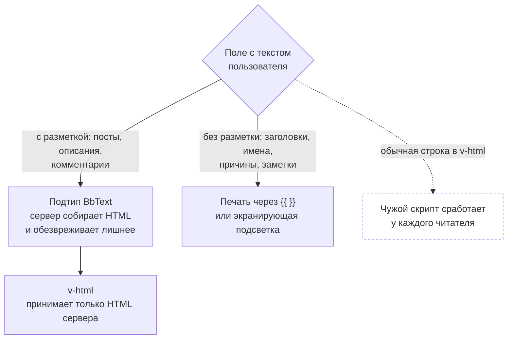

# Рендеринг BBCode

SSOT конвенций рендеринга пользовательского контента BBCode. Описывает **правила**, по которым работает система, а не текущую имплементацию.

## Принцип: сервер — единственный render authority

Пользовательский контент в BBCode рендерится **исключительно на сервере**. Клиент никогда не вызывает renderer для display-путей: он биндит HTML, уже отрендеренный сервером (`v-html` на строковом поле, пришедшем в ответе API).

**Почему:** конфиденциальность. Приватный тег `[private]` должен фильтроваться **до сериализации JSON**, иначе скрытый контент попадает на клиент к неавторизованному зрителю. Клиентский rendering не может обеспечить этот инвариант — любой пользователь открыл бы DevTools и прочитал raw payload. (`[mod]` публичен на чтение и в этой фильтрации не участвует; его ограничение — на запись, см. раздел ниже.)

**Исключение — редактор.** Редактор BBCode поддерживает два режима: WYSIWYG (default, визуальное превью) и raw BBCode (source of truth, именно он отправляется на сохранение). Переключение между режимами — внутренняя задача редактора, не display-путь. Клиентский BBCode↔HTML конвертер существует **только** для редактора и используется только в модуле редактора. В тех же рамках он рисует предпросмотр описания тега в окне тега (`hintToHtml`, раздел "Описание тега: [tip]"): предпросмотр рисует ту же строку разметки, что сервер для поверхности Hint, а на страницу по-прежнему попадает только разметка сервера.

## Разбор и место политики

Пользовательская разметка разбирается на сервере ровно один раз: из сохраненного текста в дерево. Между разбором и выводом разметка не существует в виде строки, и никакой проход по строке — ни нормализация, ни вырезание, ни кодирование — не стоит ни до разбора, ни после него. Правило проверяется глазами: если правка добавляет обработку пользовательского текста регулярным выражением где-либо, кроме объявленного фильтра значения одного атрибута, она нарушает конвенцию. Исключений три, все объявлены ниже и все с рамками: клиентский конвертер редактора, санитайзер привилегированной разметки на путях сохранения и второй замок над уже очищенным производным представлением.

Слоев четыре, и обязанности между ними не смешиваются.

1. **Грамматика** отвечает на вопрос "что здесь написано". Она объявлена декларативно: тег, его атрибуты, форма каждого значения. Зависит только от текста и ни от чего больше.
2. **Политика** отвечает на вопрос "можно ли показать это этому читателю здесь". Применяется проходом по построенному дереву и зависит от узла, зрителя, поверхности и намерения рендера. Все, для чего надо знать зрителя, поверхность, аудиторию или адресата, — политика, и ничего из этого не живет в грамматике.
3. **Вывод** собирает результат и кодирует каждое значение в момент записи, по той позиции, куда оно пишется: текст, значение атрибута, адрес, сегмент пути, значение атрибута в BBCode-выводе (там значение пишется как есть, в прямых двойных кавычках, потому что экранирования в разметке нет; значение, которое грамматика записать не дает, в такой вывод не попадает). Вывод не принимает решений: он получает дерево, к которому политика уже применена, и не обращается ни к данным, ни к правам.
4. **Запись** проверяет структурную допустимость и полномочия автора и пишет имена тегов строчными (раздел "Регистр имен"). Это единственное место, где пользовательский текст меняется.

Порядок "разбор, политика, вывод" исключений не имеет. Изменение разметки после применения политики запрещено: два прохода с одной грамматикой над разными строками — класс уязвимости, а не неудобство.

**Грамматика сервера объявлена в одном месте и в одном экземпляре.** Всякий серверный потребитель — разбор, вывод, валидатор сохранения, поиск — читает ее оттуда. Грамматика не встраивается вторым описанием ни в схему базы, ни в выражение запроса, ни вторым проходом по тексту. Клиентский конвертер редактора — признанное исключение: его грамматику держит та же общая таблица, что и серверную (раздел "Грамматика разметки"), на пути отображения он не выходит, а его расхождение с сервером не может стать дефектом безопасности, потому что сохраненный текст сервер разбирает заново.

Признанных исключений на сервере два, и оба названы поименно. Санитайзер привилегированной разметки живет на слое записи, ничего не рисует, стирает надмножество того, что разбор читает этим тегом, и только удаляет маркеры объявленного имени; надмножество обязано закрываться свойством, а не разбором случаев. Второй замок над производным представлением допустим только поверх представления, из которого разметка уже убрана проходом по дереву, и только на удаление — над сырым текстом он не замок, а вторая грамматика. Поэтому текст, который разбор не строит (вложенность глубже предела), поиск индексирует только до первого `[private` в любом регистре и дальше не индексирует ничего: без дерева нельзя сказать, где блок кончается, а вырезание по шаблону второго замка кончало блок на первом `[/private]` и оставляло в индексе остаток внешнего блока.

**Хранится исходный текст автора.** Дерево, HTML, текстовое представление и поисковая проекция производны и обязаны быть перестраиваемыми из исходника. Рендер к данным не обращается.

**Все старые теги обязаны работать; новое делается поверх них.** Ни одно написание, работавшее раньше, не вправе перестать работать или начать значить другое. Всякий новый атрибут — надстройка: тег без него остается законным навсегда и рисуется как рисовался. Правило обязано закрываться тестом на каждый тег старого набора, а не общим утверждением.

## Правило безопасного отказа

Узел, не прошедший грамматику или политику, не выводит разметку: он выводит литералы собственного открывающего и закрывающего тегов, экранированные по позиции вывода, а его дети проходят политику обычным порядком — и в режиме эмиссии родителя, потому что режимы, которые узел навязывал бы детям как разметка, отвергнутый узел не навязывает. Исходник узла целиком не выводится никогда: отказ на предке напечатал бы приватные блоки внутри него. Единственное исключение — приватная разметка: она стирается вместе с поддеревом и без следа, потому что показать ее исходник значит показать секрет. По этому же правилу печатаются картинка или ссылка с отвергнутым адресом, незакрытый парный тег и закрывающий тег, которому нечего закрывать: написанное, которое оформлением не стало, показывается так, как набрано, а не пропадает.

Отказ от тега целый, а не частичный: запись, которая не совпала с грамматикой хотя бы в одном параметре, отменяет разметку тега, и отдельные параметры поодиночке не отбрасываются (что считается битой записью, сказано в разделе "Грамматика разметки"). Незакрытый парный тег оформлением не считается: его открывающий тег печатается как набран, а содержимое показывается по своим правилам, как если бы тега не было. Незакрытый `[noparse]` в том числе: блок без закрывающего тега не показывает содержимое как набрано, и все после него разбирается обычно, скрывающая разметка тоже. Закрывающий тег, которому нечего закрывать, печатается как набран. Для скрывающей разметки незакрытость отказ только усиливает: такой узел остается узлом до конца текста, стирается политикой и отвергается на сохранении структурной проверкой по дереву, а не подсчетом тегов в тексте. Проверка покрывает пять написаний: незакрытый узел, закрывающий токен, не закрывший ни одного узла, скрывающий узел внутри скрывающего, скрывающий токен после незакрытого `[noparse]` и скрывающий узел на поверхности, которая его имени не объявляет. Первое и третье — вопросы к дереву (незакрытый скрывающий блок остается в дереве узлом до конца текста), второе разбор отдает отдельной диагностикой, потому что закрывающий токен, которому нечего закрывать, узла не оставляет, четвертое — вопрос к порядку токенов в тексте, пятое — вопрос к каталогу. Четвертое отвергается, хотя показ скрытое не раскрывает: автор такой записи почти всегда писал пример и забыл закрывающий тег, и без отказа его пример молча стал бы скрытым блоком, а `[/private]` из примера закончил бы блок раньше, чем задумал автор, и открыл бы остаток. Поэтому отвергается всякий токен скрывающей разметки, открывающий и закрывающий, стоящий где угодно после незакрытого `[noparse]`, до конца текста, а не только до конца тега, внутри которого этот блок стоит. Путь сохранения других тегов не читает и конца такого тега не видит, а ошибка в эту сторону дает лишний отказ, а не показ. Проверка разметки в редакторе называет те же случаи. Стоит проверка на всяком пути, принимающем пользовательскую разметку на сохранение, правилом, а не перечнем поверхностей: перечень отстает от кода молча. Закрытым узел делает только собственный закрывающий тег того же имени; закрытие чужим и конец текста признака не выставляют.

**Отказ обязан быть понятен автору, иначе он неотличим от поломки.** Всякий отказ по скрывающей разметке называет написание и его место в тексте, а не только факт; на поверхности, которая такой разметки не объявляет, он называет еще и то, где она работает, и способ показать ее примером. Молча стирать текст автора вместо отказа нельзя: скрытие защищает от читателя, а не от автора собственного черновика, и человек, увидевший пустоту на месте своего абзаца, ищет пропажу вместо того, чтобы переписать. Стирание при этом с показа не снимается: оно остается вторым замком для текста, который путь сохранения не проходил, то есть уже лежащего в базе или перенесенного с DM2.

**Границы значения атрибута — часть правила отказа, а не деталь разбора.** Ни одно значение не переходит через `[` и через перевод строки: скобка начинает следующий тег, и значение, дотянувшееся до нее, — это значение, которое не закрыли. У тега, чье значение не терминировалось, литерал открывающего тега равен `[имя`, а разбор возобновляется сразу за именем. Иначе отказ печатает не написанный тег, а весь остаток текста, вместе со скрывающей разметкой внутри, которую тогда некому стереть.

**Отказ обязан иметь узел, которому он адресован.** Узел создается по имени тега, а не по успеху чтения его атрибутов: узел создается и тогда, когда разметка дальше имени не состоялась, а непрочитанное значение равно отсутствующему. Для имен класса стирания это безусловно: имя порождает узел даже при незакрытой скобке, потому что тег, который разбор не собрал, отдает свое содержимое родителю, и для приватного блока это показ секрета всей комнате. Имя тега читается как токен: `[имя` есть тег только тогда, когда за именем идет `]`, `=`, пробельный символ или конец ввода, иначе тегом становится слово в прозе. Пробельный символ здесь, как и при обрезке адреса и логина, это любой символ, которому Юникод дает свойство White_Space: обычный пробел, неразрывный, U+3000 и другие. U+FEFF к ним не относится. Клиент сверяет по тому же списку, а не средствами языка: у JavaScript пробелов то меньше, то больше, и `[quote`, U+3000, `]` была битой цитатой для сервера и текстом для редактора, а закрывающий тег дальше по тексту закрывал на двух сторонах разные теги.

**Исключение из этой безусловности ровно одно, и оно же есть способ написать такую разметку буквально.** Внутри `[noparse]`, закрытого собственным закрывающим тегом, не разбирается ничего, и токен скрывающей разметки там узла не создает: закрытый блок есть письменное заявление автора "показать буквально". Такой блок один: `[code]` только меняет шрифт, и внутри него скрывающая разметка скрывает, как везде (раздел "[code] и [noparse]"). Закрыть `[noparse]` может только его собственный закрывающий тег, а не чужой и не подъем по предкам. Блок, который автор не закрыл, заявления собой не несет: его открывающий тег печатается текстом, а все после него разбирается обычно, и скрывающая разметка там становится узлом по общему правилу. Пример перед разбором или нет, решает ровно один признак: стоит ли дальше в тексте закрывающий тег этого блока. Отдельного механизма для сомнения не нужно, потому что без закрывающего тега примера нет.

Закрывающий токен читается тем же правилом токена; внутри закрытого `[noparse]` он, как и открывающий, ничего не значит. Имена тегов и параметров сравниваются без учета регистра и только по латинским A-Z: `[B]`, `[Private]` и `[/PRIVATE]` значат то же, что строчные. Сравниваются коды ASCII, а не средствами языка без учета регистра: такие средства у сервера и клиента складывают буквы по-разному, и тогда одну запись две стороны прочтут по-разному (подробно в [SECURITY.md](../conventions/SECURITY.md), раздел о конфиденциальности BBCode). Имя читается только из латинских букв, так что буква другого алфавита делает его словом в прозе, а не тегом. Класс стирания объявлен одним списком там же, где грамматика; политика и проверки читают имена оттуда и своих перечней не держат.

## Surface — семантическая поверхность контента

Каждая строка BBCode принадлежит одной семантической поверхности, определяющей допустимый набор тегов. Surface задается на уровне маппера при сериализации; допустимость тега на поверхности объявлена в каталоге тегов и применяется политикой, а не грамматикой.

| Surface | Где используется | `[private]` | `[mod]` |
|---|---|---|---|
| GamePost | Игровые посты | ✅ | ✗ |
| Comment | Тела топиков, все комментарии, блоги, ревью, любой текст над общей prose-семантикой | ✗ | ✅ |
| GlobalChatMessage | Сообщения глобального чата (картинки см. в разделе "Картинки общего чата") | ✗ | ✅ |
| Profile | Био, тексты профиля, разделы карточки персонажа | ✗ | ✗ |
| DirectMessage | Личные сообщения (1-на-1) | ✗ | ✗ |
| Hint | Описание тега игры, в его подсказке (раздел "Описание тега: [tip]") | ✗ | ✗ |

Первые пять — поверхности содержимого: набор тегов у них общий, и различаются они `[private]` и `[mod]`. Hint — поверхность со своим набором, одним тегом `[tip]`, и ни один тег поста разметкой там не является. "Любая поверхность" в таблице грамматики и в проверках, которые перебирают поверхности, значит пять поверхностей содержимого, а строки Hint называют ее поименно.

Surface — это класс эквивалентности набора тегов, а не 1:1 отражение сущности. Несколько типов контента с одинаковой tag-семантикой делят один surface (комментарии, тела топиков и prose-поля используют `Comment`). Новый surface заводится **только** когда набор допустимых тегов реально отличается; дублировать уже существующий набор под новым именем — over-engineering.

Обычный тег вне своего surface разметкой не становится и остается в тексте буквально: отдельного отказа на сохранении для него нет. Скрывающая разметка — исключение: на поверхности, которая ее имени не объявляет, путь сохранения отвергает текст с названной причиной, а не стирает молча (правило безопасного отказа выше). Второй замок стоит на показе. Разбор узнает скрывающую разметку на всякой поверхности по тому же правилу токена, и на поверхности, которая ее не объявляет, такой блок стирается целиком и без следа для всех читателей, автора тоже: на странице, в текстовом виде и в поиске. Так закрыт текст, который путь сохранения не проходил: уже лежащий в базе и перенесенный с DM2.

## Грамматика разметки

Грамматика одна для сервера и клиента, и держит ее общая таблица [bbcodeGrammar.cases.ts](../../src/DM.Web.Client/src/shared/lib/utils/bbcodeGrammar.cases.ts). Каждая строка таблицы — ввод, поверхность и ожидаемый результат в нейтральной записи: тег с параметрами, текст как набран, скрытый блок и кто его видит, тире. Серверный тест читает таблицу из файла и сверяет с ней показ, сохранение и поисковую проекцию, клиентский сверяет с ней конвертер редактора и проверку разметки. Здесь записано правило, а таблица — его исполняемая половина: спорный случай решает строка таблицы, и правка правила приходит вместе с новыми строками.

### Набор тегов

Все теги DM2 работают так же, как на DM2, в голой форме: `[b]`, `[i]`, `[u]`, `[strike]`, `[code]`, `[spoiler]`, `[nsfw]`, `[ul]`, `[ol]`, `[li]`, `[img]адрес[/img]`, `[link]адрес[/link]`, `[private="имена"]`, `[quote]`, `[tab]`, `[noparse]`, `[mod]`. Ссылка `[link]адрес[/link]` показывает слово "ссылка". `[code]` меняет шрифт на моноширинный и больше ничего не делает, `[noparse]` показывает содержимое как набрано (раздел "[code] и [noparse]"). Сохраненный текст не переписывается ни при показе, ни при правке, никакой автоматической замены старой записи новой нет: автор получает в редактор ровно то, что написал. Оговорок две, обе ниже: имена тегов, которые сохранение и правка автора пишут строчными, и символы направления текста.

Пункт `[li]`, набранный внутри другого пункта без своего `[ul]` или `[ol]` между ними, рисуется отдельной строкой, а не пунктом. Браузер закрывает открытый пункт там, где открывается следующий, если между ними нет списка, и заглядывает при этом внутрь спойлера, цитаты, 18+ и скрытого текста: в `[li]а[spoiler][li]б[/li]в[/spoiler][/li]` "б" и "в" вставали под закрытым спойлером и читались, не раскрывая его. Строкой пункт остается там, где набран, и закрытый спойлер показывает только "а". Пункт в своем списке и пункт вне всякого списка рисуются пунктом.

Сверх DM2 есть четыре формы.

- `[spoiler text="Подпись кнопки"]...[/spoiler]` меняет надпись на кнопке спойлера. Подпись остается на кнопке и у раскрытого спойлера, нажатие по ней сворачивает его: подпись называет то, что внутри, и раскрытый спойлер ее не теряет. Без `text` или с `text=""` кнопка, как на DM2, называется "Показать содержимое", а у раскрытого "Скрыть содержимое".
- `[img width="300" height="200"]https://example.com/a.png[/img]` задает размер картинки. Каждый параметр необязателен. Размер задается целым числом пикселей от 1 до 9999 и работает как предел: картинка не шире и не выше заданного, меньшая не растягивается, а шире колонки картинка не рисуется в любом случае. Задана одна сторона: вторая считается по пропорции. Заданы обе: картинка вписывается в эту рамку без искажения. Описания (`alt`) у картинки нет: читатель его не видит, и текст, которого не видно на странице, годится для оскорбления, которое никто не заметит. `alt` в теге картинки, в том числе `alt=""`, это неизвестный параметр, и такой тег печатается как набран (раздел "Битый тег").
- `[link text="Главная"]https://example.com/[/link]` показывает свой текст вместо слова "ссылка". Без `text` или с `text=""` показывается "ссылка".
- `[mention]Логин[/mention]` ставит ссылку на профиль пользователя (раздел "Упоминание" ниже).

Адрес картинки и ссылки принимается только с http и https и не может указывать на машину читателя или его локальную сеть. Имя с точкой в конце то же имя: `localhost.` и `127.0.0.1.` отвергаются так же, как без точки. Отвергается и запись, которую разные разборщики адресов читают по-разному: обратная косая черта до пути (браузер читает ее как косую, и `https://a.com\@b` для него адрес a.com), пустой хост (`https:///a.com/`), знак процента и пустая метка в хосте. Сервер и редактор принимают одни и те же адреса, и тест держит их на списке адресов общего алфавита генеративных проверок ([TESTING.md](../guides/TESTING.md#генеративные-проверки-разметки)). Тег с отвергнутым адресом печатается так, как набран: скобки тега текстом, адрес на своем месте, а картинки и ссылки нет, и в общем чате такой тег под спойлер не прячется. Так же он выглядит в текстовом виде. Автор и читатель видят, что именно не сработало, а не пустое место. Между тегами картинки и ссылки стоит только адрес, поэтому ссылки в ссылке и упоминания в ссылке не бывает: такая запись — битый тег.

`[private]` пишется как на DM2: `[private="Вася, Петя"]...[/private]`. Имена разделяются запятой, пробелы вокруг имени отбрасываются, в самом имени можно пробелы и кавычки. Значение кончается на `"]`, и больше ничто его не кончает. `[private]...[/private]` без имени — скрытый текст, который видят только мастер и ассистенты игры, а автор поста видит его, как и любой свой блок. Это не заметки мастера, а обычный скрытый блок без адресата.

Скрытый текст на странице, как на DM2, просто зеленый текст (`$text-green`) в строке, среди текста вокруг: без фона, рамки и отступов, и строки он не кончает. Кому он виден, текстом поста не пишется: это говорит подсказка над зеленым текстом, "Получатели: DungeonMaster, Assistant, Вася, Петя". Строка " (Получатели: ...)" за блоком была и убрана: подсказка говорит то же, а длинные неразрывные слова строки ("DungeonMaster,", имя) не влезали в конец выровненной по ширине строки, и остаток строки раздавался немногим пробелам перед ними, так что слова скрытого текста расходились на несколько пробелов. Сервер пишет получателей на самом блоке, в атрибуте `data-recipients` у `span.private-message`, и они уходят туда же, куда блок: читателю, у которого блок вырезан, не достаются и они. Первыми получатели называют ведущих, так, как их называют посты DM2, латиницей, терминами: ведущие видят любой скрытый текст игры. За ними идут имена из тега, через запятую, без пробелов вокруг имени и без пустых. Имя, которое совпадает с `DungeonMaster` или `Assistant` (регистр букв не важен), второй раз не пишется. У блока без имен, у `[private=""]` и у всякого битого написания получатели называют одних ведущих: "DungeonMaster, Assistant". Термины написаны тем же текстом, что и имена. Получатели не бывают пустыми и не пишут "нет": запись, где нет ведущих, читалась бы так, будто блок не видит никто. Наведение мышью на зеленый текст через 0,6 с показывает подсказку над строкой под указателем, на длинном блоке там, где читают; ссылка, спойлер и картинка внутри отвечают на щелчок сразу. На касание подсказка открывается по правилу подсказок сайта (CODE_STYLE.md, Tooltips) с одним дополнением: первое касание скрытого текста открывает подсказку, куда бы оно ни пришлось, на ссылку, спойлер или картинку внутри тоже, и больше ничего не делает; пока подсказка открыта, касание ссылки переходит по ней, спойлера раскрывает его, картинки открывает ее целиком. Иначе скрытый текст, который целиком ссылка или спойлер, на телефоне не сказал бы, кому он виден. При выделении мышью подсказка не появляется, в копию она не попадает. С клавиатуры и в программе чтения с экрана получателей не узнать: у блока нет остановки Tab, чтобы комната не получала ее на каждом зеленом куске.

### Перевод строки после блока

Блок стоит на своих строках. Это `[quote]`, `[spoiler]`, `[nsfw]`, `[mod]`, списки и их пункты. Один перевод строки, набранный вплотную за закрывающим тегом блока, страница не рисует: блок уже закончил строку, и текст после него начинается на строке под блоком. Так же читается перевод строки перед блоком, и пустой строки нет ни над блоком, ни под ним. Без этого правила под каждым блоком, записанным на своей строке, стояла пустая строка, а над ним не стояла. Второй перевод строки подряд рисуется, это пустая строка, которую автор поставил сам.

Правило касается только перевода строки вплотную за закрывающим тегом. Текст, набранный после блока на той же строке, кончается своим переводом строки как обычно, и следующая строка к нему не приклеивается. Если между блоком и переводом строки стоит другой тег, перевод строки принадлежит ему и рисуется. Тег, который стоит в строке (`[b]`, `[code]`, ссылка, картинка), строку не кончает, и перевод строки после него остается. Битый блок, напечатанный как набран, строку тоже не кончает.

Скрытый текст `[private]` в строке, как `[b]`, и строки не кончает: у того, кто его видит, переводы строк до него и после рисуются как набраны, и скрытый текст, записанный на своей строке, так на своей строке и стоит, получатели за ним в той же строке. У читателя, от которого он спрятан, строки, на которой не было ничего, кроме спрятанных от него блоков, нет вовсе: она уходит вместе с одним из переводов строки вокруг нее, как если бы автор ее не набирал (раздел "Zero-information erase"). Текстовый вид и поиск читают так же. Правка автора получает каждый перевод строки как набран (раздел "Асимметричный контракт редактора"). Превью редактора пустой строки под блоком тоже не рисует: перевод строки за блоком там край абзаца под ним.

### Как пишутся параметры

Параметр пишется только как `имя="значение"`. Имя — латинские буквы, в любом регистре (раздел "Регистр имен"). Значение всегда стоит в прямых двойных кавычках, числа тоже: `width="300"`. Пары отделяются от имени тега и друг от друга пробелом, пробелов может быть несколько, порядок любой, и каждый параметр встречается не больше одного раза. Других пробелов в теге нет, ни вокруг `=`, ни перед `]`.

Значение кончается на кавычке, за которой идет `]` или пробел и следующее `имя=`. Все, что стоит до нее, входит в значение, включая другие кавычки, поэтому экранирования нет: `text="он сказал "да" и ушел"` читается целиком. Цена такого правила в том, что внутри значения нельзя записать `"]` и `" имя=`, и окна редактора такое значение не принимают. Открывающая скобка `[` и перевод строки в значении недопустимы (границы значения описаны в правиле безопасного отказа). Ограничитель значения один, прямая кавычка `"`; другие символы кавычек ограничителем не считаются и внутри значения остаются обычными символами.

Главное стоит внутри тега: адрес у картинки и ссылки, логин у упоминания, скрытый текст у спойлера. Знака `=` сразу после имени тега нет ни у одного тега, кроме `[private]`.

### Регистр имен

Регистр имени тега и имени параметра ничего не значит: `[B]` работает так же, как `[b]`, а `[IMG WIDTH="300"]` так же, как `[img width="300"]`. Закрывающий тег тоже: `[b]текст[/B]` закрыт. Повтор параметра считается без учета регистра, поэтому `width="300" WIDTH="400"` — повтор. Без учета регистра сравниваются только латинские A-Z, по кодам ASCII, и сервер и клиент сравнивают одинаково (правило безопасного отказа выше). Имя с буквой другого алфавита, например со знаком Кельвина вместо k, тегом не становится и печатается как набрано.

Редактор сам пишет имена строчными: так их пишут его окна, кнопки и визуальный режим, когда строят тег заново. Набранное автором в другом регистре превью и обратное преобразование возвращают как набрано. Правка автора, которую собирает сервер, возвращает имена строчными: разметка для правки регистра не помнит, а смысла он не несет.

Сохранение тоже пишет имена строчными, на всяком пути, который принимает разметку: пост, топик, комментарий, публикация, отзыв, сообщение, описание, текст профиля, значение персонажа, обращение в поддержку. `[B]текст[/B]` сохраняется как `[b]текст[/b]`, `[SPOILER TEXT="Карта"]` как `[spoiler text="Карта"]`, `[PRIVATE="Вася"]` как `[private="Вася"]`. Меняется только регистр латинских букв в именах тегов и параметров того, что разбор прочел как разметку. Значения параметров и адресаты не меняются, как и все, что тегом не стало: битый тег, незакрытый тег, лишний закрывающий, текст в квадратных скобках, все внутри закрытого `[noparse]`, тег, которого на этой поверхности нет (`[MOD]` в игровом посте). Внутри `[code]` теги работают, и их имена пишутся строчными, как везде. Страница, правка автора и текстовый вид показывают сохраненный текст так же, как набранный, а повторное сохранение ничего не меняет. Что тег, а что текст, решает сам разбор: имена переписываются по дереву, а не проходом по строке.

### Битый тег

Тег, запись которого не совпала с грамматикой, показывается так, как набран, вместе со своим закрывающим тегом, а его содержимое рисуется обычно. Опечатка видна автору и читателю сразу, а не пропадает молча. Битым считается:

- неизвестный параметр, опечатка в имени параметра, `alt` у картинки;
- значение без кавычек, незакрытое значение, повтор параметра, `[` или перевод строки в значении, лишний пробел в теге, размер вне 1..9999 или не число;
- знак `=` или параметр у тега без параметров: `[code="x"]`, `[code lang="js"]`, `[noparse=x]`, `[b=1]`, `[quote="Имя"]`, `[tab=1]`;
- формы, которых нет ни на DM2, ни в этом правиле: `[img=...]` в любом виде, `[link=...]`, `[spoiler=...]` с кавычками и без, `[mention="..."]`;
- значение на закрывающем теге: `[/b="x"]` не закрывает `[b]` и печатается текстом;
- содержимое картинки, ссылки или упоминания, которое не является одним адресом или одним логином.

Битый `[noparse]` содержимое как набрано не показывает: запись с ошибкой не является заявлением автора "показать буквально", поэтому разметка внутри разбирается обычно, скрывающая тоже.

Цена правила: `[spoiler]` или `[nsfw]` с опечаткой в параметре покажет содержимое открыто. От этого защищает проверка разметки в редакторе, которая называет причину до отправки (раздел "Предупреждения редактора").

### Незакрытый тег и лишний закрывающий

Парный тег, который автор открыл и не закрыл, оформлением не считается: его открывающий тег печатается как набран, а содержимое показывается по своим правилам, как если бы тега не было. `Он сказал: [quote]я приду завтра` остается строкой текста со скобками, а не рамкой цитаты на весь остаток поста. Правило одно на все теги: забытый `[b]` тоже покажет скобки, а не жирный текст до конца. Закрытым тег делает только его собственный закрывающий тег. Закрывающий тег внешнего блока закрывает этот блок, и все, что открыто внутри него и не закрыто, печатается как набрано: в `[quote]раз [b]два[/quote]` рамка цитаты есть, а `[b]` внутри нее текстом.

Незакрытые `[code]` и `[noparse]` подчиняются тому же правилу. Незакрытый `[noparse]` примером не считается: его открывающий тег печатается текстом, а все после него разбирается обычно, и типографика, и теги, и скрывающая разметка.

Закрывающий тег, которому нечего закрывать, печатается как набран: `закрывается так: [/b]` остается ровно этим текстом.

Исключение одно, скрывающая разметка: незакрытый `[private]` остается скрытым блоком до конца текста, а сохранение такого текста отказывает (раздел ниже). Проверка разметки в редакторе называет и незакрытый тег, и лишний закрывающий.

### [code] и [noparse]

`[code]` работает как на DM2: меняет шрифт на моноширинный и больше ничего. Он стоит в строке, как `[b]`, а пробелы и переводы строк внутри него сохраняются как набраны. Разметка внутри работает как везде: теги, тире, упоминания, картинки и скрытые блоки. Закрывается `[code]` по общему правилу: `[code][b]раз[/code] два[/b]` дает моноширинное "[b]раз", а `[b]` внутри и `[/b]` после печатаются текстом, как у любого другого тега. Незакрытый `[code]` печатается скобками, его содержимое показывается по своим правилам, и скрытый блок после него остается обычным скрытым блоком: сохранение его не отвергает.

`[noparse]` показывает содержимое как набрано: внутри не читаются ни теги, ни тире, ни скрывающая разметка. Это единственный способ показать разметку примером. Блок заканчивается на первом своем закрывающем теге в любом регистре имени, `[/noparse]` или `[/NoParse]`, и больше его не закрывает ничто: закрывающий тег внешнего блока внутри него это текст, а блок, в котором стоит `[noparse]`, остается незакрытым, если его закрывающий тег оказался внутри примера. `[noparse]` внутри `[noparse]` вложенным блоком не становится: `[noparse]раз [noparse]два[/noparse] три[/noparse]` показывает пример "раз [noparse]два", а последний `[/noparse]` закрывать нечего, он печатается текстом.

Показать теги буквально моноширинным шрифтом можно так же, как это делают на DM2: `[code][noparse][b]пример[/b][/noparse][/code]`. Обратное сочетание, `[noparse][code]...[/code][/noparse]`, показывает и `[code]` текстом.

Блок "показать как набрано" открывает только верная и закрытая запись `[noparse]`. Битая запись (`[noparse=x]`, `[noparse text="x"]`) и незакрытая заявления автора "показать буквально" не несут, и разметка после них разбирается обычно, скрывающая тоже. Скрывающая разметка после незакрытого `[noparse]` скрывает, но сохранение такого текста отказывает (правило безопасного отказа). Внутри закрытого `[noparse]` проверка разметки в редакторе не называет ничего.

### Скрытый блок [private]

Из правила битого тега есть одно исключение, ради безопасности. Битый скрытый блок текстом не становится: всякое написание, где за `[private` в любом регистре идет `]`, `=`, пробел, перевод строки или конец текста, остается скрытым блоком. Если написание не совпало ни с `[private="..."]`, ни с голым `[private]`, блок видят только те, кто видит голый. Сюда относятся `[private=Вася]` без кавычек, незакрытая кавычка, `[private to="Вася"]`, пробел вокруг `=`, перевод строки в имени или после имени тега, `[` в имени. Открывающий тег такого блока тянется до первой `]`, если она стоит раньше следующей `[`; иначе блок начинается сразу за именем тега. Регистр имени, как у всех тегов, битым написание не делает: `[PRIVATE="Вася"]` — тот же блок, что `[private="Вася"]`, а `[Private]` — тот же, что `[private]`.

Закрывает блок только `[/private]` без значения, в любом регистре. `[/private="x"]` блок не закрывает, и он продолжается: сомнение о границе стирания решается в сторону большего стирания.

Сохранение такого текста отказывает на каждом пути сохранения, называет написание и его место в тексте и показывает верную запись, `[private="Имя"]` или `[private]`. Показ, правка автора и поисковая проекция вырезают блок одинаково, потому что читают его одним разбором, а второй замок поиска узнает те же написания.

`[private]` внутри `[code]`, закрытого или нет, это обычный скрытый блок: `[code]` только меняет шрифт, и в игровом посте сохранение такой блок принимает. Незакрытый `[noparse]` выше по тексту скрытый текст ниже тоже не открывает: блок без закрывающего тега примером не считается, и `[private]` после него остается обычным скрытым блоком со своим закрывающим тегом. Сохранение такого текста при этом отказывает и называет незакрытый `[noparse]` (правило безопасного отказа). Закрытый `[noparse]`, в любом регистре имени, показывает такую разметку примером, и сохранение ее принимает. Закрывающий `[/private]` внутри закрытого `[noparse]` в скрытом блоке тоже пример: блок он не заканчивает.

Скрытый блок внутри скрытого сохранение отвергает. Внутренний блок видят только те, кто видит оба, но автор такой записи почти всегда забыл закрыть первый блок, и сомнение здесь решается отказом, а не догадкой.

На поверхности, где `[private]` не объявлен, сохранение его записи отказывает с названной причиной и подсказывает, как показать ее примером (раздел "Surface"). Текст, который путь сохранения не проходил, такой блок никому не показывает: разбор узнает его по тому же правилу, что в игровом посте, и политика стирает его целиком и без следа для всех читателей, автора тоже, на странице, в текстовом виде и в поиске. Незакрытый блок стирается до конца текста, как в игровом посте. Внутри `[code]` такой блок стирается так же. Правка автора получает такую запись как набрана, текстом: автор должен ее увидеть и убрать, а не потерять молча при следующем сохранении, и отказ на сохранении назовет ему причину. Закрытый `[noparse]` показывает ее примером и здесь.

### Символы направления текста

Символы, которые переворачивают видимый порядок букв, U+202A..U+202E и U+2066..U+2069, убираются из текста до разбора, тем же проходом, что и управляющие символы. Читатель видит буквы в том порядке, в каком они записаны, и такой символ не разрывает имя тега и значение: `[b`, символ, `]` читается как `[b]`, а имя адресата с таким символом внутри читается без него. Правило записано дважды, в разборе и в чтении текста путем сохранения, и оба места убирают одно и то же, иначе сохранение и страница прочтут разный текст ([SECURITY.md](../conventions/SECURITY.md), "Путь сохранения читает тот же текст, что и разбор"). Клиентский конвертер редактора до чтения убирает те же символы и те же управляющие символы, а непарный суррогат заменяет на U+FFFD, как разбор. Иначе `[nopa`, U+0001, `rse]` был бы для превью текстом, а для страницы примером, и превью показывало бы скрытым блоком то, что страница печатает примером всей комнате. Так превью показывает то же, что страница, а обратное преобразование возвращает текст уже без них. Остальные символы направления, например метки U+200E и U+200F, порядок букв не переворачивают и остаются.

### Типографика

Как на DM2, `--` становится коротким тире "–", а `---` длинным "—". Замена идет по тексту на всех поверхностях содержимого, внутри `[code]` тоже: он меняет только шрифт. Описание тега (Hint) тире не получает: описание всегда показывалось как набрано, и предпросмотр в окне тега рисует ровно то, что увидит читатель. Ничего не заменяется внутри `[noparse]`, в значениях параметров (подпись спойлера, текст ссылки, имена в `[private]`), в адресах и логинах.

Строка `___` ничем не становится и печатается как набрана, на всех поверхностях и в любом месте текста: горизонтальной линии в разметке нет, как нет ее на DM2.

Правка автора получает текст как набран, без тире, поэтому повторное сохранение текста не меняет. Превью редактора тоже показывает `--` и `---` как набраны: в редакторе лежит черновик автора, а не страница читателя.

### Чего в разметке нет

`[cut]` не тег: ни сервер, ни клиент его не знают, и он печатается как набран. Строка `___` не линия, а `alt` не параметр картинки (разделы "Типографика" и "Набор тегов"). `[tip:...]` и `[tipimg:...]`, прежняя запись подсказок в описаниях тегов, тегами не являются нигде и печатаются как набраны; описание тега пишет подсказку к слову тегом `[tip]` (раздел "Описание тега: [tip]"). На поверхностях содержимого текстом печатается и `[tip]`. `[*]` не элемент списка: списки пишутся через `[li]`, новое написание отложено, пока на ручном наборе списков никто не спотыкается.

### Картинки общего чата

Картинка общего чата прячется под спойлер только в компактном режиме чата, в обычном режиме она видна сразу. Режим выбирает читатель, и хранится он на его устройстве, так что сервер режима не знает. Поэтому решение поделено так.

Сервер на поверхности GlobalChatMessage при показе отдает каждую картинку внутри спойлера: кнопка "Показать содержимое" и блок с картинкой, та же разметка, что у `[spoiler]`, плюс отметка `data-bb-gate="image"` на обоих элементах. Отметка отличает этот спойлер от спойлера, который написал автор. Правка автора такого спойлера не получает, и в редакторе он не появляется. Безопасный показ (`embed_safe`) прячет картинки под спойлер всегда, режима у него нет.

Клиент решает в одном месте, в компоненте сообщения чата, по его режиму. В обычном режиме спойлер с отметкой раскрыт и без кнопки: картинка стоит на своем месте, как в посте. В компактном режиме это обычный спойлер. Смена режима пересчитывает уже показанные сообщения. Спойлер, написанный автором, от режима не зависит и закрыт в обоих.

### Упоминание

`[mention]Логин[/mention]` работает на всех пяти поверхностях и во всех намерениях рендера: тег входит в общую часть набора тегов, из которой собран набор каждой поверхности (`BbParserProvider.DefaultTags`), и любая аудитория получает его одинаковым. Рисуется оно ссылкой "@Логин" на страницу профиля `/users/Логин`, логин в адресе кодируется, а `data-bb-tag="mention"` и `data-bb-user` дают правке автора вернуть тег. В текстовом виде (письма, поиск) это "@Логин". Существование пользователя не проверяется, уведомлений упоминание не шлет. Внутри `[noparse]` это текст, внутри `[code]` упоминание, как везде. Логин — непустой текст без `[` и перевода строки, пробелы по краям в него не входят. Кнопки упоминания в редакторе нет.

### Описание тега: [tip]

Описание тега игры показывается в подсказке тега: в облаке тегов, в столбце тегов списка игр и в выборе тегов игры. Это поверхность Hint, и тег у нее один, `[tip]`: слово, которое при наведении или касании показывает свою маленькую подсказку, текст или картинку.

```
[tip text="Политика, религия, национальные конфликты"]спорные[/tip]
[tip img="/images/erp-tooltip.gif"]эротические сцены[/tip]
[tip img="https://example.com/a.gif" text="Подпись под картинкой"]слово[/tip]
```

`text` показывает текст, `img` картинку, оба вместе дают картинку с подписью под ней. Параметры пишутся как у всех тегов (раздел "Как пишутся параметры"), в любом порядке. Адрес здесь стоит в параметре, а не между тегами, как у `[img]` и `[link]`, и для разметки проекта это новое: между тегами стоит слово. Новый вид подсказки, если понадобится, станет параметром `[tip]`, а не третьим тегом.

Слово — текст в одну строку, в котором есть что-то кроме пробелов, без тегов внутри. Тег печатается как набран, по общему правилу битого тега, когда он: без `text` и без `img` (и с `text=""` или `text` из одних пробелов), с неизвестным параметром, незакрытый, со словом в две строки или с тегом внутри слова, `[tip]` внутри `[tip]` в том числе. Адрес картинки принимается по правилу `[img]` (раздел "Набор тегов") и еще путь на самом сайте, одна косая черта в начале: `/images/erp-tooltip.gif`. Без пути картинку из папки сайта не записать, у стенда и боевого сайта разные адреса, а новой возможности он не дает: `[img]` принимает полный адрес этого же сайта. `//хост`, `/\хост`, обратная косая черта где угодно в пути, пробел и управляющий символ отвергаются. Тег с отвергнутым адресом печатается как набран.

`[noparse]` показывает пример как набран, как везде. `[private]` на этой поверхности читается и стирается у всех, а сохранение его отвергает с названной причиной и советом взять его в `[noparse]` (раздел "Скрытый блок [private]"). Перевод строки рисуется переводом строки, тире не заменяются (раздел "Типографика"). В текстовом виде `[tip]` — его слово, а отвергнутый — запись как набрана.

Сервер отдает описание в публичном каталоге тегов собранным HTML, как любой текст. Слово стоит в `<span class="bb-tip" tabindex="0" data-tip-text="..." data-tip-img="...">`, текст и значения кодируются по месту записи. Картинки в разметке нет, только адрес в атрибуте: ее запрашивает подсказка, когда читатель ее открыл, а не каждая страница со списком тегов. Под-подсказку рисует клиент из атрибутов привязкой, без `v-html`. Описание рисуется для показа, какое бы намерение рендера ни назвал запрос: каталог тегов кэшируется публично без `Vary`, и публичный ответ одинаков для любого `X-Dm-Audience` ([API_DESIGN.md](../conventions/API_DESIGN.md), "Кеширование ответов"). Разборщик у поверхности один на все намерения: безопасный показ прочел бы в описании теги поста, а правки автора у описания нет, модератор правит сырую строку. В модерации карточка тега показывает описание так же, как видит читатель, а окно тега получает сырую строку отдельным полем.

Имена атрибутов — договор сервера и клиента, и держат его пары [hintMarkup.cases.ts](../../src/DM.Web.Client/src/shared/lib/utils/hintMarkup.cases.ts): ввод и строка разметки, которую обязаны дать и сервер, и предпросмотр. Таблица грамматики говорит нейтральными кусками и имен атрибутов не держит.

Сохранение пишет имена строчными, как везде (раздел "Регистр имен"). `[tip]`, который печатается как набран из-за своих параметров, остается как набран: сохраненный строчными, он поменял бы скобки на странице. Писать описание может старший модератор и выше, описание не длиннее 500 знаков.

На телефоне под-подсказка открывается касанием слова по правилу подсказок сайта. Тег в облаке и в списке игр — ссылка, и касание по нему ведет на список с фильтром, а не открывает подсказку; касанием подсказку тега открывает выбор тегов игры (кнопка тега показывает подсказку после того, как сработала) и карточка тега в модерации. Касание слова внутри открытой подсказки ее не закрывает. `tabindex` у слова дает касанию и клавиатуре фокус там, где текст стоит на странице: в карточке тега и в предпросмотре окна. Внутри подсказки, перенесенной в конец страницы, Tab до слова не доходит, и под-подсказки там клавиатуре недоступны.

Окно тега пишет `[tip]` двумя кнопками над полем описания, с именами тега, как в редакторе: `tip text` и `tip img`. Кнопка открывает под собой панель вставки редактора со словом, уже выделенным в поле, текстом подсказки или адресом изображения и необязательной подписью, и обертывает слово тегом, картинку перед подписью. Панель не принимает значение, которое запись не выдержит, и адрес не по правилу выше. Под полем стоит проверка разметки того же вида и теми же словами, что в редакторе, а под ней предпросмотр: пузырь подсказки над названием тега, открытый и в потоке окна, со словами, которые работают как у читателя. Визуального режима у поля нет: в описании одна-две фразы с одним видом тега, и модератору надо видеть подсказку, а не отформатированный текст.

### Редактор

Редактор в обоих режимах, его окна вставки и справка пишут только формы из этого раздела, и имена тегов и параметров строчными. Окно ссылки спрашивает адрес, только с http и https, и необязательный текст и пишет `[link]адрес[/link]` или `[link text="..."]адрес[/link]`. Окно картинки спрашивает адрес, ширину и высоту и пишет только заполненное, в порядке width, height. Окно приватного текста принимает имена через запятую или пустое поле и пишет `[private="..."]` или `[private]`. У спойлера есть необязательная подпись. Значение, которое правило записать не дает (`"]`, `" имя=`, `[`, перевод строки), окно не принимает и говорит почему.

Справка показывает настоящие примеры с настоящими именами параметров, например `[link text="Главная"]https://example.com/[/link]`. Проверка разметки в редакторе не ругается на то, что пишут его собственные окна, а что и какими словами она называет, записано ниже.

### Предупреждения редактора

Проверка разметки в режиме BBCode называет то, что страница покажет не так, как автор, скорее всего, задумал, и то, что сохранение отвергнет. Она читает текст той же грамматикой, что сервер, и молчит на всякой правильной разметке: на всем, что пишут окна и кнопки редактора, на строках таблицы грамматики без `broken` и на всем, что стоит внутри закрытого `[noparse]`, как бы оно ни выглядело. Битый или незакрытый `[noparse]` примером не является, и после него проверка читает текст обычно.

Причина каждой находки записана кодом из перечня ниже, и строка таблицы с `broken` несет ровно этот код. Под одним кодом бывает несколько текстов, по случаю. Текст стоит после номера строки, где находится названная запись: "Строка 3: [b] не закрыт, добавьте [/b]". Текст одним предложением, без точки в конце: что не так и как исправить. В фигурных скобках подстановка: `{тег}` имя тега строчными, `{параметр}` имя параметра, как набрано, `{запись}` тег, как набран, не длиннее 40 знаков, с многоточием, если обрезан.

| Код | Когда | Текст |
|---|---|---|
| `value-after-name` | `=` после имени у `[img]` | `[img] пишется без = после имени: [img width="300"]адрес[/img]` |
| | `=` после имени у `[link]` | `[link] пишется без = после имени: [link text="Текст"]адрес[/link]` |
| | `=` после имени у `[spoiler]` | `[spoiler] пишется без = после имени: [spoiler text="Подпись"]` |
| | `=` после имени у `[mention]` | `[mention] пишется без = после имени: [mention]Логин[/mention]` |
| | `=` после имени у `[tip]` | `[tip] пишется без = после имени: [tip text="Текст"]слово[/tip]` |
| | `=` после имени у тега без параметров | `у [{тег}] нет значения, пишется просто [{тег}]` |
| `unknown-param` | неизвестное имя у тега с параметрами | `у [{тег}] нет параметра {параметр}, есть только {параметры}`, где `{параметры}` для `[img]` "width и height", для `[link]` и `[spoiler]` "text", для `[tip]` "text и img" |
| | параметр без имени у тега с параметрами | `в [{тег}] параметр пишется как имя="значение", например {пример}`, где `{пример}` для `[img]` `width="300"`, для `[link]` и `[tip]` `text="Текст"`, для `[spoiler]` `text="Подпись"` |
| | параметр у тега без параметров | `у [{тег}] нет параметров, пишется просто [{тег}]` |
| `unquoted-value` | значение без кавычек или имя без `=` | `значение {параметр} пишется в прямых кавычках: {параметр}="..."` |
| `repeated-param` | параметр второй раз, в любом регистре | `параметр {параметр} указан дважды, оставьте один` |
| `bracket-in-value` | `[` в значении | `символ [ в значении {параметр} не допускается, уберите его` |
| `newline-in-value` | перевод строки в значении | `значение {параметр} пишется в одну строку` |
| `unterminated-value` | у значения нет закрывающей кавычки | `у значения {параметр} нет закрывающей кавычки перед ]` |
| `stray-space` | лишний пробел у тега с параметрами | `лишний пробел в [{тег}]: пробел ставится только перед именем параметра` |
| | лишний пробел у тега без параметров | `лишний пробел в [{тег}], пишется просто [{тег}]` |
| `bad-number` | размер не целое число от 1 до 9999 | `значение {параметр} должно быть целым числом от 1 до 9999` |
| `bad-content` | в `[img]` или `[link]` не один адрес | `между [{тег}] и [/{тег}] пишется только адрес` |
| | в `[mention]` не один логин | `между [mention] и [/mention] пишется только логин` |
| | в `[tip]` не слова в одну строку или тег внутри слова | `между [tip] и [/tip] пишутся слова в одну строку, без тегов` |
| | `[tip]` внутри `[tip]` | `[tip] внутри [tip] не работает` |
| `missing-param` | у `[tip]` нет ни `text`, ни `img` | `у [tip] нужен text или img: [tip text="Текст"]слово[/tip]` |
| `bad-address` | адрес не на http или https | `адрес в [{тег}] должен начинаться с http:// или https://` |
| | адрес картинки `[tip]` не на http, https и не путь сайта | `адрес в [tip] должен начинаться с http://, https:// или /` |
| | адрес на машине читателя, в его сети или не читается | `адрес в [{тег}] указывает на локальную сеть или записан с ошибкой` |
| `value-on-closing-tag` | значение у закрывающего тега | `закрывающий тег пишется без значения: [/{тег}]` |
| `private-spelling` | битое написание скрытого блока | `{запись} записан неверно, скрытый текст пишется [private="Имя"] или [private]` |
| | закрывающий тег со значением | `{запись} не закрывает скрытый текст, закрывает только [/private]` |
| | скрытый блок не закрыт | `скрытый текст не закрыт, добавьте [/private]` |
| | токен скрытого блока после незакрытого `[noparse]` | `{запись} не станет примером: [noparse] выше не закрыт тегом [/noparse]` |
| `private-nested` | скрытый блок внутри скрытого | `скрытый текст внутри скрытого не работает, закройте первый тегом [/private]` |
| `private-outside-game` | скрытый блок вне игрового поста | `скрытый текст работает только в игровых постах, для примера оберните его в [noparse]` |
| `unclosed` | тег не закрыт | `[{тег}] не закрыт, добавьте [/{тег}]` |
| `stray-closing` | закрывающему тегу нечего закрывать | `[/{тег}] ничего не закрывает, уберите его или откройте [{тег}] выше` |
| | открытый тег того же имени стоит снаружи скрытого блока, в котором стоит закрывающий | `[/{тег}] не закрывает [{тег}] снаружи скрытого текста, перенесите его за [/private]` |
| `too-deep` | вложенность глубже 512 уровней | `теги вложены глубже 512 уровней, такой текст покажется без оформления` |

`too-deep` в таблице грамматики строк не имеет: такой ввод держат тесты конвертера редактора. `private-outside-game` называется один раз на текст, по первому токену, как отказывает сохранение. Неизвестный тег (`[s]`, `[cut]`, `[color=red]`) и тег, которого на этой поверхности нет (`[mod]` в игровом посте), предупреждения не дают: они печатаются как набраны, и проверка не может знать, разметка это или текст в квадратных скобках.

### Цена разбора

Разбор линеен по длине текста. Чтение тега с параметрами смотрит каждый символ ограниченное число раз и не откатывается назад на строках вида `[img` с тысячами пробелов после имени, с многими парами `a="1"` или с многими кавычками подряд. Каждая такая форма закрыта проверкой роста цены в `BbParserCostShould`.

### Сид стенда

Сид пишет только действующие формы, упоминания в том числе пишутся как `[mention]Логин[/mention]`. Сид — первый текст, который видит всякий, кто открывает стенд, и битая запись в нем выглядит поломкой.

## Инвариант prose-полей

Два жестких правила связывают тип поля в ответе сервера с тем, куда его
печатает клиент:



1. **Текст с разметкой несется подтипом `BbText` и печатается только через `v-html`.**
   Любое поле, куда человек пишет свободный текст с разметкой и которое видят
   другие, обязано нестись подтипом `BbText` (`PostBbText`, `CommonBbText`,
   `InfoBbText`): тогда сервер сам соберет из разметки HTML и обезвредит все,
   что автор написал похожего на разметку самой страницы. Вставка `v-html` во
   Vue кладет строку в страницу как есть, ничего не обезвреживая, поэтому
   принимать она вправе только HTML, собранный сервером из `BbText`, либо
   строку, прошедшую через экранирующую подсветку `highlightMatch()`.
2. **Поле без разметки печатается через `{{ }}`.** Заголовки, имена, отзывы о
   сайте, рекомендации, причины предупреждений и решений модерации, личные
   заметки — это по замыслу простой текст. Исключения два: причина бана и
   причина предупреждения пишутся в редакторе разметки и несутся
   `CommonBbText`, как комментарий без контекста; причина снятия бана и
   пояснение изменения баллов остаются простым текстом. Он печатается через `{{ }}` или той
   же экранирующей подсветкой, но никогда сырой строкой в `v-html`.

Обычная строка, дошедшая до `v-html`, — это дыра, и вот какая. Человек пишет в
свой пост или в свое имя кусок страницы со скриптом. Сервер сохраняет это как
текст. Дальше скрипт срабатывает в браузере у каждого, кто откроет страницу, и
работает от лица открывшего: читает его переписку, пишет от его имени, меняет
его настройки — сайту это неотличимо от действий самого человека. Опасна тут
именно сохраненность: сработает не у того, кого удалось заманить по ссылке, а у
всех подряд и сколько угодно раз.

Новое поле со свободным текстом по умолчанию получает подтип `BbText`,
повторяющий ближайшее существующее поле (например, ревью игры зеркалит ревью поста, описание блога зеркалит описание топика).

## Audience — семантическое намерение рендера

Audience — это **намерение**, а не формат. Клиент передает audience в HTTP-заголовке при запросе, сервер рендерит под выбранное намерение.

| Audience | Назначение | Правила |
|---|---|---|
| `display` | Стандартное чтение | `[private]` фильтруется по правам зрителя; `[mod]` виден всем. Default. |
| `author_edit` | Автор загружает свой контент в редактор | Теги рендерятся с `data-bb-*` round-trip атрибутами (см. контракт редактора ниже). Выдается только автору контента. |
| `plain_text` | Email, нотификации | Чистый текст без служебных знаков (раздел "Plain-text каналы"). `[private]` безусловно вырезается; `[mod]` рендерится как обычный тег. Viewer считается анонимным. |
| `embed_safe` | Link preview, cross-post embed | NSFW-safe набор тегов, `[private]` вырезается; `[mod]` рендерится. |

Неизвестное значение audience → трактуется как `display`. Клиент, запрашивающий `author_edit`, получает его только если он автор запрашиваемого контента.

**Где проверяется авторство.** При рендере каждого поля, а не на эндпоинте: заголовок один на весь ответ, а один ответ несет контент разных авторов, поэтому эндпоинт не может ответить на вопрос "автор ли зритель" для всего тела сразу. Обязанность эндпоинта другая — положить в контекст рендера идентификатор автора контента; отсутствие идентификатора трактуется как "не автор" и дает `display`.

## Матрица видимости privacy-тегов

### `[mod]`

`[mod]` — **публичный на чтение, ограниченный на запись**. Это визуальный блок ("сообщение модератора"), а не приватный контент: он рендерится одинаково для **всех** зрителей, включая гостей. Читательской фильтрации по правам у `[mod]` нет — на `display`, `plain_text` и `embed_safe` он ведет себя как обычный форматирующий тег.

Ограничение — на **запись**: авторить `[mod]` может только Moderator+ (Moderator / SeniorModerator / Admin / System). Если автор ниже Moderator сохраняет `[mod]`, тег молча **разворачивается** на сохранении (маркеры удаляются, внутренний текст остается) — без ошибки и без потери данных. Ведущие игры (master / assistant) — это игровые роли, а не роли сайта, и правом авторить `[mod]` не наделены.

| Audience | Роль зрителя | Результат |
|---|---|---|
| `display` | любая (вкл. гостя) | ✅ виден как mod-блок |
| `plain_text` / `embed_safe` | любая | ✅ внутренний текст рендерится (как обычный тег) |
| `author_edit` | автор | ✅ виден с `data-bb-tag="mod"` |

Точка контроля записи — `ModBlockSanitizer` в доменном слое; вызывается на каждом raw-BBCode save-пути, чей контент рендерится на surface Comment или GlobalChatMessage. Невалидное (неавторизованное) `[mod]` разворачивается там до сохранения.

### `[private]`

`[private]` валиден только в GamePost. Правило видимости — **OR-объединение** следующих условий (любое из них дает доступ):

1. **Author-forever**: зритель = автор поста. Работает всегда, даже если автор больше не активен в игре (snapshot `PostAuthorUserId`).
2. **Addressee-forever**: зритель — владелец одного из персонажей-адресатов блока. Работает всегда, даже если персонаж больше не активен в игре (snapshot per-block).
3. **Game lead**: зритель — master или assistant игры. Наставник **НЕ** является ведущим и сюда не входит.
4. **Per-post override `SharePrivateWithAll`**: в настройках поста автор отметил, что приватный текст видит любой, кто может читать пост.
5. **Per-room override `ViewPrivateText`**: в настройках комнаты включено "все участники видят приватный текст".

Важно: расширения 4 и 5 работают **только внутри множества тех, кто уже имеет доступ на чтение комнаты**. Если у зрителя нет `RoomAccess`, пост вообще не загружается (гейт query-слоя), визитор недостижим. Расширения не дают доступа к контенту тем, кто не может читать саму комнату.

Расширения 4 и 5 открывают только блок с адресатами. Голый `[private]` и всякое битое написание (раздел "Скрытый блок [private]") видят автор поста и ведущие игры, и никто больше: адресата у такого блока нет, а настройка поста или комнаты делится текстом, адресованным персонажам.

**Moderator+ НЕ видит `[private]`** — никакого audit audience, никакого backdoor. Только по перечисленным условиям.

#### Имя адресата и переименование

Скрытый блок адресуется именем персонажа. По имени персонажа находят один раз,
при сохранении поста, и дальше пост помнит самого персонажа, а не надпись. Само
имя ни за кем не закреплено навсегда: его можно сменить, а освободившееся имя
может взять другой персонаж. Поэтому одна и та же надпись в теге способна
означать одного персонажа в блоке, для которого ее уже разобрали, и другого в
блоке, написанном позже. По тексту эти два блока не различить: в нем не записано,
какое сохранение какой блок написало.

Отсюда четыре правила.

- **По написанному имени сегодня находится персонаж, за которым этот пост его не
  закреплял.** Сохранение отвергается, причина называется в тексте отказа. Кому
  адресован секрет, спрашивают у автора, а не угадывают. Цена правила названа
  прямо: автор может упереться в отказ из-за переименования, которого сам не
  делал.
- **По написанному имени сегодня не находится никто**, потому что персонажа
  переименовали или он ушел из игры. Работает "адресат навсегда": читатель, за
  которым блок закреплен, его не теряет. Это обычный ход правила, а не спорный
  случай.
- **Автор сам вписал нынешнее имя того же персонажа.** Такой надписи в посте еще
  не было, ее разбирают по сегодняшнему составу комнаты, и блок попадает к тому
  же читателю.
- **Пост сохранен до того, как в нем стали запоминать персонажа.** Такие посты
  читаются как раньше и отказа не поднимают. "Неизвестно" не значит "другой", а
  отказ по неизвестности запретил бы правку каждому старому посту.

**Получатели блока называют тех, за кем блок закреплен, а не то, что
написано в теге.** Текст тега авторский и остается как написан. Получатели,
собранные из него, назвали бы того, кто носит это имя сегодня, а он блока не
видел. Если пост помнит не все имена адресатов блока, получатели называют
имена из тега, как называли всегда. Ведущие стоят первыми в любом случае, а у
блока без адресатов получатели называют одних ведущих: "DungeonMaster,
Assistant" (раздел "Набор тегов").

| Audience | Условие | Результат |
|---|---|---|
| `display` | любое из 1–5 | ✅ виден |
| `display` | ни одно из 1–5 | ❌ вырезан |
| `display` | поверхность, где `[private]` не объявлен | ❌ вырезан у всех, у автора тоже |
| `author_edit` | автор (сверен при рендере) | ✅ виден с `data-bb-tag="private" data-bb-addressees="..."` |
| `author_edit` | поверхность, где `[private]` не объявлен | текстом, как набран |
| `plain_text` / `embed_safe` | любое | ❌ вырезан |

## Правило ведущих игры

**Ведущие игры = `GameRole.Master` + `GameRole.Assistant`.** Наставник (`GameRole.Mentor`) **не** является ведущим: он просто помогает участникам игры, не ведет ее. Это правило фиксировано на уровне render-контракта: коллекция `GameLeadUserIds` в контексте рендера включает master + assistants и **не** включает наставников.

## Zero-information erase

Фильтрация privacy-тегов — **чистое удаление субтри без следов**. Когда блок вырезан:

- Нет placeholder-элементов.
- Нет HTML-комментариев.
- Нет whitespace-gap'ов, телеграфирующих наличие скрытого контента.
- Нет DOM-атрибутов "здесь было что-то".
- Нет пустых тегов вокруг вырезанного. Тег, в котором, кроме вырезанных блоков, ничего не было, кроме пробелов и переводов строк, не выводится вовсе, как если бы автор его не написал: `Раз [b][private]x[/private][/b] два` у такого зрителя это "Раз  два" без пустого жирного элемента, спойлер вокруг одного скрытого текста пропадает вместе с кнопкой. Тег, набранный пустым (`[b][/b]`), выводится как прежде: из него ничего не вырезано.
- Нет тегов, напечатанных текстом из-за вырезанного. Тег с одним значением (ссылка, картинка, упоминание) читает значение без вырезанного блока: `[link]https://example.com/[private]x[/private][/link]` у такого зрителя рабочая ссылка "ссылка" (или ее `text`), а не `[link]` и адрес текстом. Ссылка, в которой, кроме вырезанного, ничего не было, не выводится, как пустой тег выше. Автору и тем, кто блок видит, такая ссылка показывается как набрана, как всякий тег, в значении которого стоит разметка.
- Нет типографики через вырезанное. Вырезанный блок не склеивает текст по обе стороны от себя: в `а-[private]x[/private]-б` дефисы остаются дефисами, как их набрал автор, и в тире не превращаются.
- Нет пустых строк на месте вырезанного. Строка, на которой не было ничего, кроме вырезанных блоков (и тегов, которые из-за них не выводятся), уходит вместе с одним переводом строки: `капитана.\n[private]...[/private]\nПотом` у такого зрителя это "капитана.", перевод строки, "Потом", как в тексте, где этой строки нет. Строкой считается текст между двумя переводами строки (CR LF или LF), а начало и конец всего текста строку тоже начинают и кончают, так что блок в самом начале или в самом конце рядом с переводом строки уходит так же. Внутри тега строкой считается только текст между двумя его переводами строки: сам тег может стоять посреди строки текста. Исключение - последняя строка незакрытого тега, который тянется до конца текста: она кончается там же, где текст. Строка, на которой есть что-то еще, хоть пробел, остается: этот пробел автор набрал, и он стоит там и без блока. Текст, в котором после вырезания не осталось ничего, кроме пробелов и переводов строк, не выводится вовсе, как текст из одних пробелов. Автору и тем, кто блок видит, все строки рисуются как набраны.

Результат: неавторизованный зритель не может даже определить факт наличия скрытого контента в посте. Ответ ему не зависит от того, что блок держал, какой он длины и кому адресован, и не держит пустых тегов и пустых строк, которых автор не писал: это держат свойства `BbMarkupPropertiesShould.LeaveNoTraceOfABlockTheReaderDoesNotRead` и `LeaveNoLineOfABlockTheReaderDoesNotRead` на порожденных текстах для каждого читателя каждой поверхности, текстового вида и безопасного показа.

## Асимметричный контракт редактора

Редактор использует асимметричный пайплайн:

- **Загрузка на редактирование**: сервер возвращает HTML (`author_edit` audience), в котором каждый тег обращается в BBCode однозначно.
- **Сохранение**: клиент отправляет BBCode (конвертация Tiptap HTML → BBCode на клиенте).

Почему асимметрично: клиентский BBCode-парсер не может безопасно рендерить privacy-теги (см. принцип выше); клиентский HTML-парсер может корректно извлечь `data-bb-*` атрибуты и восстановить BBCode без потери данных.

**Способ обратимости один на все теги.** Тег, чья разметка чтения в BBCode однозначно не обращается, получает серверный вариант для `author_edit`: элемент разметки чтения с `data-bb-tag`, а значение атрибута, если оно есть, едет в своем `data-bb-*`, как адресаты `[private]`. Клиент разбирает такой элемент по `data-bb-tag`, и второго способа, например узнавания тега по классу, не заводится. Части разметки, которые существуют для читателя (заголовок спойлера, получатели скрытого текста, спойлер перед картинкой), в вариант не входят: маркера у них нет, и в редакторе они стали бы текстом. Тег, у которого на чтении нет своего элемента, получает элемент ради маркера. Тег, чья разметка чтения обращается однозначно и без маркера, варианта не получает.

Разметка для правки автора начинается с маркера `<span data-bb-breaks="written"></span>`: в ней каждый перевод строки записан как `<br />`, и ничто другое его не означает. Визуальный режим своих переводов строки между блоками не пишет и считает, что блок стоит на своей строке, если не сказано, что он приклеен. Без маркера два блока, набранные вплотную, возвращались с переводом строки между ними, по одному лишнему за каждую правку. Перевод строки из CR LF или одного CR это один `<br />`: браузер превращает каждый CR в LF, и редактор CR не держит. Списки в разметке для правки записаны тегами как набраны, в элементах, которые браузер не перестраивает: текст между пунктами, переводы строк между ними, список из одного текста и пункт внутри пункта возвращаются автору как набраны. Пустая подпись спойлера (`text=""`) тоже возвращается.

Круг "рендер `author_edit`, обратное преобразование, BBCode" закрыт парным тестом на каждый тег каждой поверхности. Пары записаны один раз, в клиентском тесте: клиент проверяет, что из разметки получается BBCode, сервер проверяет, что пара совпадает с его рендером. Тег поверхности без пары роняет серверную половину.

**Вложенные блоки обращаются изнутри наружу.** Разметка блока читается до первого закрывающего тега, поэтому внешний блок, обращенный раньше внутреннего, заканчивается на чужом теге, и два тега выходят перекрещенными: `[spoiler][mod]текст[/spoiler] хвост[/mod]`. Текст после внутреннего блока при этом молча меняет блок на сохранении. Клиент обращает сперва тот блок, внутри которого блоков больше нет, и повторяет проход, пока обращать нечего. В таблице пар вложенность держат строки с блоком внутри блока и текстом после внутреннего.

**Редактор читает и пишет разметку по той же грамматике, что и сервер.** Клиентский конвертер держит та же таблица (раздел "Грамматика разметки"): формы, параметры и битые записи он понимает так же, а внутри закрытого `[noparse]` не читает ничего. `[code]` в обоих режимах редактора держит разметку внутри себя, как `[b]`, и обратное преобразование возвращает ее тегами, а не текстом. Круг "превью, обратное преобразование" возвращает автору набранный текст без изменений, имена в любом регистре и неразрывные пробелы тоже. Убираются только символы направления текста, до чтения, как на сервере. Неразрывные пробелы вставленного из другого документа текста становятся обычными при вставке, а не на обратном пути.

Визуальный режим вправе перестроить текст (список перестроек с причинами в `visualMode.spec.ts`), но показ остается прежним: каждое слово нарисовано тем же и читается теми же читателями. Три правила держат это. Форматирование ставится снаружи ссылки, иначе жирный вокруг `[link]` пропадал. Пункт списка, который начинается с блока, получает в визуальном режиме пустую строку перед ним: схема редактора требует строки первой, и вложенный список уходил из пункта. Скрытый блок, чья запись кончается сразу после имени, получает пробел перед тегом, который визуальный режим поставил перед его текстом, иначе `[private` и `[u]` переставали быть блоком, и его текст видела вся комната.

Набранное в визуальном режиме на экране текст, и там, где от прочтения зависит, кто его прочтет, обратное преобразование записывает его текстом. `[/private]`, набранный внутри скрытого блока (в том числе в адресе картинки), и `[/noparse]`, набранный внутри примера, пишутся примером самих себя, иначе они заканчивали блок раньше, и остаток блока читала вся комната. `[noparse]` из текста, после которого стоит закрывающий тег примера, а между ними начинается скрытый блок документа, тоже пишется примером самого себя, иначе пример забирал блок и печатал его всем. Прочее набранное, например `[b]`, остается как набрано: так обратное преобразование возвращает автору любой текст, прочитанный из BBCode. Управляющие символы и символы направления обратное преобразование убирает до этой проверки, как сервер до чтения.

**Редактор поддерживает два режима:**
- **WYSIWYG** (default) — визуальное превью того, что будет отправлено.
- **BBCode source** — прямой ввод BBCode, это именно то, что уходит на сервер на сохранение.

Вне зависимости от активного режима, на сохранение идет BBCode-представление.

## Contract render context

Маппер, формирующий BbText-поле DTO, обязан заполнить envelope — "провенанс" контента, необходимый рендереру для корректной фильтрации:

- **Surface** — семантическая поверхность.
- **PostAuthorUserId** — автор (для author-forever).
- **GameId** — игра, к которой относится контент.
- **GameLeadUserIds** — master + assistants (для lead-override).
- **PrivateAddresseeOwnerUserIdsByAttribute** — per-block снимок владельцев адресатов.
- **PrivateAddresseeNamesByAttribute** — имена адресатов из того же снимка, для получателей за блоком.
- **PostSharePrivateWithAll** — per-post override.
- **RoomViewPrivateText** — per-room override.

Viewer в envelope **не кладется** — он резолвится per-request из authorization context. Envelope безопасно делить между пользователями: он не содержит per-user данных.

## Кэширование

Результат рендера не кэшируется: каждый вызов парсит исходный текст заново.

Кэш здесь заводится только вместе с ключом, включающим **причину видимости**, а
не зрителя и не его роль. Приватный блок виден по нескольким несводимым
причинам — автор, адресат, ведущий игры, per-room и per-post override, — и ключ,
который их не различает, склеивает двух зрителей с разными правами в одну
запись. Цена ошибки несимметрична: промах кэша стоит разбора строки, а лишнее
попадание показывает чужой приватный текст. Ключ по зрителю безопасен, но
бессмыслен — hit-rate такого кэша стремится к нулю.

## Plain-text каналы

Email и прочие небезопасные каналы (нотификации) рендерят только `plain_text` audience: privacy-теги вырезаются безусловно, без учета получателя. Причина: email'ы пересылаются, кэшируются, архивируются — любая попытка per-recipient редакции не выдерживает критики. Снимок на момент отправки считается окончательным.

Текстовый вид — чистый текст, а не кусок HTML. В нем нет сущностей и тегов разметки: `<`, `>` и `&` остаются собой, перевод строки остается переводом строки, тире пишутся символами "–" и "—", а запись, которая оформлением не стала, печатается как набрана. Экранирует такой текст тот, кто вставляет его в HTML, в момент вставки, как любое значение. Поиск индексирует его как есть и ничего в нем не раскодирует: раскодирование превратило бы набранное автором `&lt;` в `<`.

## Как добавить новый тег

1. Записать тег и его параметры в раздел "Грамматика разметки" и добавить строки в [таблицу грамматики](../../src/DM.Web.Client/src/shared/lib/utils/bbcodeGrammar.cases.ts): каждая форма, каждая битая запись и поверхности, где результат отличается.
2. Зарегистрировать тег в parser-provider'е для соответствующих surface'ов (`GetForSurface`).
3. Если разметка чтения тега не обращается в BBCode однозначно, зарегистрировать его author-edit вариант с `data-bb-tag` (`GetForAuthorEdit`), добавить разбор по `data-bb-tag` в `htmlToBbcode` и пару в клиентскую таблицу круга `author_edit` (см. контракт редактора).
4. Если тег privacy-sensitive:
   - Добавить правило видимости в `PermissionFilteringVisitor` (чистая функция `(node, ctx) → bool`).
   - Добавить строку в матрицу видимости выше.
   - Добавить соответствующее расширение в Tiptap (`parseHTML` читает `data-bb-*`, `renderHTML` эмитит).
5. Покрыть тег matrix-тестами — объем обязательства в [TESTING.md](../guides/TESTING.md).
6. Добавить запись в GLOSSARY.md (термин) и SECURITY.md (если приватный).

## Связанные документы

- [AUTHORIZATION.md](AUTHORIZATION.md) — роли, intentions, модель прав.
- [API_DESIGN.md](../conventions/API_DESIGN.md) — контракт audience-заголовка.
- [SECURITY.md](../conventions/SECURITY.md) — threat model конфиденциальности.
- [PATTERNS.md](../conventions/PATTERNS.md) — структурный blueprint.
- [PERFORMANCE.md](../conventions/PERFORMANCE.md) — стратегия кэширования.
- [GLOSSARY.md](../references/GLOSSARY.md) — определения терминов.
