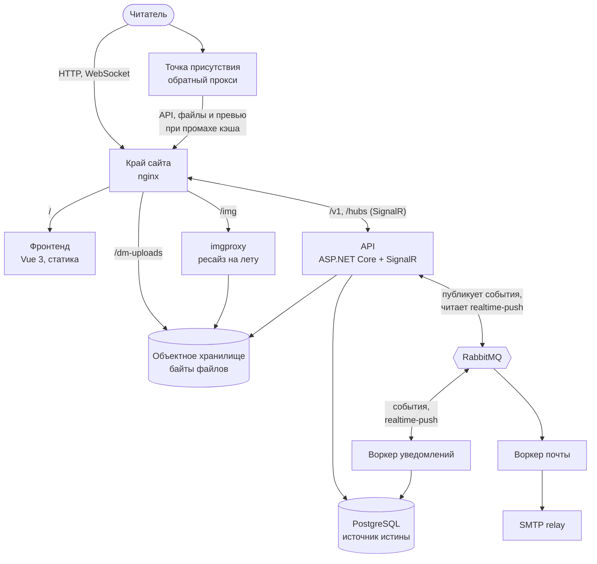
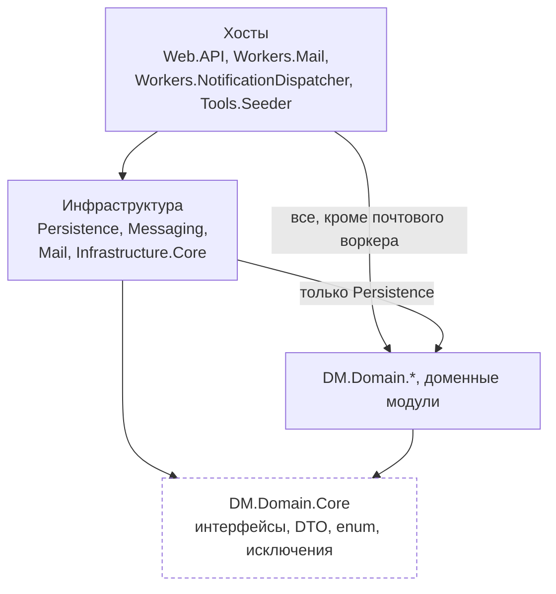
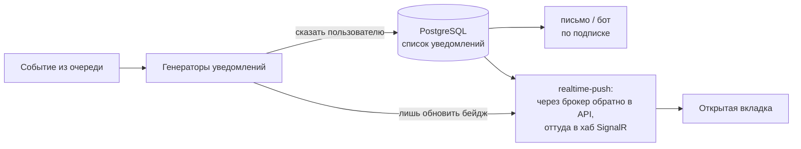

# Система DM3

Из чего состоит система, как связаны слои и как ходят события. Правило, которое держит тест или файл, называет его рядом с собой, остальное держит ревью, состояние стенда не проверяется.

## Коротко

DM3 это платформа для текстовых ролевых игр: игры, форум, блоги, личные сообщения,
общий чат, профили, модерация. Приложение одно. Доменные модули (Account, Personal,
Community, Moderation, Messaging, Game, Blog, Forum) работают в одном процессе:
`src/DM.Web.API` ссылается на все и он же разговаривает с браузером по HTTP.

**Источник истины PostgreSQL.** Схема общая, миграция единственная, один
`DmDbContext` держит таблицы всех модулей. В объектном хранилище лежат только байты
загруженных файлов. Почему СУБД одна и как пишутся пары хранилищ, описано в
[DATA_STORAGE.md](../conventions/DATA_STORAGE.md), вторую не дает поставить
компиляция (`test/DM.Infrastructure.Persistence.Tests/EntityStorageMarkerShould.cs`).

**Главное правило, событие не носитель факта.** Доменное событие сообщает о записи,
которая уже закоммичена, и не может быть единственным местом, где она существует.
Из него следует, почему публикация не роняет запрос, почему потребитель обязан быть
идемпотентным и почему подтверждения брокера просят ровно два продюсера. На правило
ссылаются комментарии в коде и алертах (например `src/DM.Infrastructure.Mail/MailSender.cs`,
`src/DM.Infrastructure.Core/Tracing/MessagingMetrics.cs`, `docker/prometheus/alerts.yml`),
поэтому менять его в документе в одиночку нельзя.

### Топология рантайма

Развернутый стенд собирает сайт на один origin. Перед приложением стоит край на
nginx: раздает статику фронтенда, проксирует API и хаб, отдает файлы из объектного
хранилища и подписанные превью из imgproxy. Разбивка по префиксам лежит в
`docker/nginx/edge-locations.conf`, сам край появляется только в overlay
`docker/docker-compose.preview.yml`.



**Единый origin это свойство края, а не приложения.** Фронтенд просит `/v1`
относительно адреса, с которого загрузился (`docker/.env.example`). Базовый
`docker/docker-compose.yml` края и контейнера фронтенда не поднимает: dev-сервер
Vite ходит на API по абсолютному адресу из `VITE_API_HOST`, и работает CORS с
перечнем разрешенных источников (`src/DM.Web.API/Startup.cs`). Поэтому
кросс-доменная конфигурация проверяется только локально.

**imgproxy получает картинку не от API.** Приложение только подписывает URL
(`src/DM.Infrastructure.Core/Storage/ImgproxyUrlBuilder.cs`), исходник imgproxy
забирает из хранилища сам. Подпись единственное, что стоит между ним и
произвольными преобразованиями. Загрузка и отдача файлов описаны в
[UPLOADS.md](UPLOADS.md).

Наблюдаемость в схему не вынесена, она описана в
[MONITORING.md](../guides/MONITORING.md).

### Направление зависимостей

Стрелка означает ссылку проекта. Слой зависит только от слоев ниже. Фронтенд
говорит с API только по HTTP.



Остальные проекты инфраструктуры ссылаются на Infrastructure.Core, Mail еще на
Messaging, и только Persistence на доменные модули. Точный граф читается из csproj.
Почтовый воркер про домен не знает ничего.

У `Domain.Core` ссылок нет, он лист графа, и любая ссылка из него разворачивает
направление. Второй лист это завендоренный разбор BBCode (`src/BBCodeParser`): своя
сборка без ссылок, которую видит только оборачивающий ее Infrastructure.Core. Наши правки в ней есть,
каждая помечена в коде комментарием "DM3 addition against the original" рядом с местом
(`src/BBCodeParser/Tags/Tag.cs`). Правила
для такого кода и правило "бизнес-интерфейсы объявляет Domain" живут в
[PATTERNS.md](../conventions/PATTERNS.md).

| Слой | Может зависеть от | НЕ может зависеть от |
|------|-------------------|---------------------|
| Domain.Core | Только .NET BCL | Ничего из проекта |
| Завендоренная библиотека | Только .NET BCL | Ничего из проекта |
| Domain.* | Domain.Core | Других Domain.*, Infrastructure.* |
| Infrastructure.* | Domain.Core, Domain.* | Хостов |
| Хосты: Web.API, Workers.*, Tools.Seeder | Все | Ничего не запрещено |
| Web.Client | Только HTTP API | Backend напрямую |

Доменная сборка не называет инфраструктуру ни одним именем. Правило проверяется по
ссылкам сборок, а не по тексту using: тип, взятый через алиас или полное имя, в тексте
не виден (`test/DM.Architecture.Tests/DomainPurityShould.cs`, `DomainBoundaryShould.cs`).

---

## Границы модулей

Модуль не ссылается на соседний ни в одну сторону. Чужую область читают синхронно
только через контракт в ядре, а пишут в нее и вызывают побочные эффекты только
событием. Признак нарушения механический: метод контракта, который ничего не
возвращает, зовут ради эффекта (`test/DM.Architecture.Tests/CrossModuleContractShould.cs`,
`DomainBoundaryShould.cs`).
Кто чем владеет, решается вопросом "чьи это данные" в
[PATTERNS.md](../conventions/PATTERNS.md).

**Изоляция кончается на доменных модулях.** Схема общая, контекст один, Persistence
ссылается на все модули, и чтения через границу внутри этого слоя допущены
сознательно. Поэтому вынос модуля в отдельный сервис означает разделение схемы, а
не перенос кода.

**Модуль, который забыли зарегистрировать, компилируется и стартует** и отвечает 500
на первом запросе к своему эндпоинту. Хост собирает контейнер по списку маркерных
типов, написанному руками, и тест сверяет список с деревом
(`test/DM.Architecture.Tests/ModuleCompositionShould.cs`).

**Контейнер встроенный.** Почему не Autofac, записано в
[STACK.md](../STACK.md). Явное расширение `AddDmX(IServiceCollection)` есть у каждого
инфраструктурного проекта и у модуля, которому оно нужно, остальное приезжает сканом
сборки (`src/DM.Infrastructure.Core/Extensions/DefaultTypesRegistrationExtensions.cs`).
Скан только заполняет пробелы, поэтому явные регистрации идут раньше сканов, а
форвардинг-фабрики держат контракт "один инстанс на scope при нескольких
интерфейсах". Хосты включают `ValidateScopes` и `ValidateOnBuild`, и недостающая
регистрация падает при старте, а не на первом запросе. Сидер валидирует только
скоупы: его сканы тянут доменные сборки ради нескольких internal-типов и приводят
сервисы, которых он не резолвит (`test/DM.Architecture.Tests/CompositionRootShould.cs`).

---

## Жизненный цикл запроса

```
HTTP → конвейер middleware → контроллер → API-сервис → доменный сервис → репозиторий → PostgreSQL
```

Порядок конвейера задается в `src/DM.Web.API/Startup.cs` и здесь не копируется.
Обязательны четыре ограничения, каждое уже стоило дефекта.

- Разбор адреса клиента идет первым: лимитер, журнал входов и аудит читают адрес пира.
- Заголовки безопасности стоят выше всего, что пишет ответ, иначе ответы ранних
  обработчиков уходят без них.
- CORS стоит выше кеша ответов, иначе в кеш ложится ответ без CORS, и браузер
  роняет чужой 200 на все время жизни записи.
- Все, что читает метаданные эндпоинта (лимитер, авторизация), идет после
  маршрутизации, выше нее атрибуты политик инертны.

Сессия живет в куке HttpOnly, токена в JavaScript нет. Защиту от подделки
межсайтового запроса дают `SameSite=Lax` и проверка origin
(`src/DM.Web.API/Middleware/CsrfProtectionMiddleware.cs`), чеклист в
[SECURITY.md](../conventions/SECURITY.md#защита-от-атак-чеклист). Лимитер считает по
аккаунту, а имя аккаунта кладет на контекст отдельное звено, читающее только куку:
партиционер зовется синхронно и раньше, чем появилась личность. Поломка этой пары
молча переводит счет на адрес (`test/DM.Architecture.Tests/RateLimitPipelineShould.cs`).

**Хост не ходит в хранилища сам, включая фоновые задания.** Иначе продуктовое
правило (что считать популярностью, сколько живет токен) существует только в
работающем процессе, и его нельзя позвать со стороны и покрыть доменным тестом.
Исключения названы поименно, это композиционный корень и прогрев
(`test/DM.Architecture.Tests/HostStorageBoundaryShould.cs`).

**Репозиторий, который пишет дважды, пишет оба раза или ни одного.** Две записи без
обертки это две транзакции, и в зазоре живет состояние без имени: пароль сменен, а
погасивший его токен еще действует (`test/DM.Architecture.Tests/DurableWritesShould.cs`).

Формат ответов и ошибок описан в [API_DESIGN.md](../conventions/API_DESIGN.md).
Конверт клиент снимает единственным помощником
(`src/DM.Web.Client/src/shared/api/envelope.ts`).

---

## Конвейер доменных событий

События нужны, чтобы модули не знали друг о друге, а отправка письма не держала
HTTP-ответ.

```
доменная запись (коммит) → INSERT в OutboxEvents (второй коммит)
                                   ↓ relay в хосте API, тик 1 s
                             обмен событий
                                   ↓
                        очередь воркера уведомлений
```

**Публикация это вставка строки.** `SendAsync` пишет строку в OutboxEvents той же
PostgreSQL вторым коммитом сразу после доменного, своей транзакции не открывает и в
чужую не входит (`src/DM.Infrastructure.Persistence/RelationalStorage/OutboxEventProducer.cs`,
`test/DM.Architecture.Tests/EventOutboxShould.cs`). После коммита вставки доставка
at-least-once, и недоступный брокер означает задержку, а не потерю. Окно потери
остается: kill процесса между двумя коммитами и отказ самой вставки. Поэтому то, что
обязано случиться, должно быть восстановимо из состояния базы.

**Отказ вставки не роняет вызывающего.** Иначе закоммиченная запись превратилась бы в
ошибку, и клиент повторил бы ее второй раз. Продюсер сам логирует отказ и считает
метрикой, в местах вызова try и catch нет. Событие не публикуется раньше своего
коммита (`test/DM.Architecture.Tests/PublishAfterCommitShould.cs`).

**Relay живет в хосте API**, потому что outbox пишут запросы этого процесса, и
публикация не должна зависеть от чужого деплоя. Тик в секунду это вся задержка,
которую добавляет outbox. Батч берется `FOR UPDATE SKIP LOCKED`, чтобы два релея в
окне выкатки не пометили строки друг друга. Строка помечается опубликованной только
после подтверждения брокера, батч останавливается на первой отказавшей строке
(потребитель последовательный, пропуск переставил бы события), и пока батч приходит
полным, тик продолжает выгребать (`src/DM.Web.API/HostedServices/OutboxRelayService.cs`,
`src/DM.Infrastructure.Persistence/RelationalStorage/OutboxRelayProcessor.cs`).

**Доставка из очереди тоже at-least-once**, поэтому обработка с побочным эффектом
идемпотентна. EventId проставляется в единственной точке публикации и одинаков на
всех повторах, а воркер уведомлений пишет по паре (EventId, тип уведомления) под
уникальным индексом. Пустой EventId обрабатывается без дедупликации
(`src/DM.Workers.NotificationDispatcher/Dispatching/NotificationProcessor.cs`).

**Потребление последовательное, повторов пять** с удвоением паузы, prefetch 1 не
глобальный (`src/DM.Infrastructure.Messaging/DmConsumer.cs`,
`src/DM.Infrastructure.Messaging/MeasuredConsumerPipeline.cs`).

**Отравленное сообщение** после повторов отклоняется без возврата в очередь, и без
dead-letter exchange брокер его выбросит. Поэтому каждая рабочая очередь объявляет
dead-letter exchange и терминальную очередь при нем. Терминальную, потому что DLQ с
TTL и возвратом на рабочий обмен дает бесконечный цикл повторов. Исключение для
очередей одноразовых пушей, где сообщение лишь копия сохраненного состояния
(`test/DM.Architecture.Tests/DeadLetterRoutingShould.cs`).

**Подтверждение брокера просят двое.** Почтовый продюсер, потому что письмо активации
и сброса пароля из базы не восстановить, и отказ становится ошибкой запроса, которую
читатель повторит сам. Relay, потому что пометка строки без подтверждения это запись
"доставлено" о сообщении, которое брокер мог не взять, а ожидание в фоне никого не
держит. Остальным продюсерам внутри запроса ждать нельзя: это роняет запросы, работа
которых уже сделана.

**Обмен объявляет тот, кто в него публикует**, при старте и параметрами один в один с
потребителем. Иначе обмен существует только после первого старта потребителя, и
публикация в несуществующий обмен молчит
(`test/DM.Architecture.Tests/PublishedExchangeShould.cs`).

Почта в outbox не входит: письмо публикуется в отдельный обмен, который слушает
только почтовый воркер. Имена обменов и очередей живут в коде транспорта и
консьюмеров.

Транспорт это официальный RabbitMQ.Client и свой тонкий слой
(`src/DM.Infrastructure.Messaging`), где топология очереди объявлена в коде
потребителя. Почему не шина и не чужая обертка, записано в [STACK.md](../STACK.md).
Пересматривать, если понадобятся саги или несколько транспортов.

---

## Уведомления



Уведомление, которое читают списком, сохраняется и может уйти письмом или ботом.
Событие, которое лишь просит вкладку перечитать счетчик, идет тем же путем, но не
сохраняется и в письмо не попадает.

Каналы доставки читают то, что вернула запись, а не то, что ей передали: сервис
сужает круг получателей, и рассылка по исходному списку доставила бы то, что фильтр
отказался хранить. Доставка после записи идет best effort, исключение отсюда вернуло
бы обработку в повторы и переписало бы сохраненное
(`src/DM.Workers.NotificationDispatcher/Dispatching/NotificationProcessor.cs`).

Слова и адрес уведомления живут одной таблицей в домене
(`src/DM.Domain.Personal/Features/Notifications/NotificationWording.cs`,
`NotificationDestination.cs`), ее читают и воркер, и API, поэтому письмо, бот и
вкладка называют событие одинаково и ведут на одну страницу. Строку списка и push
собирает один маппер API (`src/DM.Web.API/Features/Personal/Notifications/NotificationMapper.cs`).
Порядок сведений, прочитанных из базы, не тот, в котором их записал генератор: сумка
лежит в jsonb, а он порядка ключей не держит.
Клиент событий не называет и путей не строит
(`test/DM.Architecture.Tests/NotificationVocabularyShould.cs`,
`NotificationLinkVocabularyShould.cs`).

Кому уходит уведомление о записи модерации, решает то же правило, что ее чтение:
уведомление не ведет туда, где получателя ждет 404
([AUTHORIZATION.md](AUTHORIZATION.md#обращения)).

Обратный путь до браузера идет через брокер: воркер публикует push, хост API читает
его эксклюзивной очередью и отдает в хаб. Dead-letter у этой очереди нет намеренно,
push это копия сохраненного уведомления
(`src/DM.Web.API/Realtime/RealtimeNotificationConsumer.cs`).

---

## Разметка: рендер только на сервере

Текст пользователя хранится как BBCode, в HTML его превращает только сервер, клиент
получает готовую разметку. Разбор, теги и видимость описаны в
[BBCODE_RENDERING.md](BBCODE_RENDERING.md).

**Скрывающий блок закрывается только своим тегом.** Закрывающий тег чужого имени
внутри `[private]` не закрывает ничего, иначе обычная ошибка вложенности печатала бы
остаток приватного блока всей комнате. На `[mod]` признака нет: он публичен на чтение,
и раннее закрытие стоит только форматирования (`src/BBCodeParser/Tags/Tag.cs`,
`src/DM.Infrastructure.Core/Parsing/BbParserProvider.cs`).

---

## Вход и двухфакторная аутентификация

Устройство описано в [AUTHENTICATION.md](AUTHENTICATION.md#двухфакторная-аутентификация):
между шагами входа сессии нет, письмо защиту не снимает, быстро ее снимает второй
администратор. QR рисуется своими средствами, потому что otpauth-URI содержит секрет
целиком, и это проверяется по исходникам всех проектов, включая клиент
(`test/DM.Architecture.Tests/SecondFactorSecretShould.cs`).

---

## Адреса сайта

Экземпляр приложения один, дополнительный адрес обслуживает точка присутствия
([POINT_OF_PRESENCE.md](../guides/POINT_OF_PRESENCE.md), там же общий вход между
адресами). Область куки сессии задает развертывание (`docker/docker-compose.yml`), а
выдача и снятие куки обязаны идти через один помощник: браузер заменяет куку только
при совпадении атрибутов, и разошедшийся Domain оставляет сессию, которую выход не
гасит (`src/DM.Web.API/Shared/Authentication/ApiCredentialsStorage.cs`).

---

## Проверка

Правила выше держат тесты и файлы, названные рядом с каждым. Чтением дерева не
проверяется:

- конфигурация работающего стенда (общая область куки, объявленные адреса, поднят ли
  край), ее смотрят на самой машине
- соответствие образов в реестре этому дереву, его гарантирует конвейер публикации
- живое поведение видимого человеку, оно закрывается только прогоном на стенде
