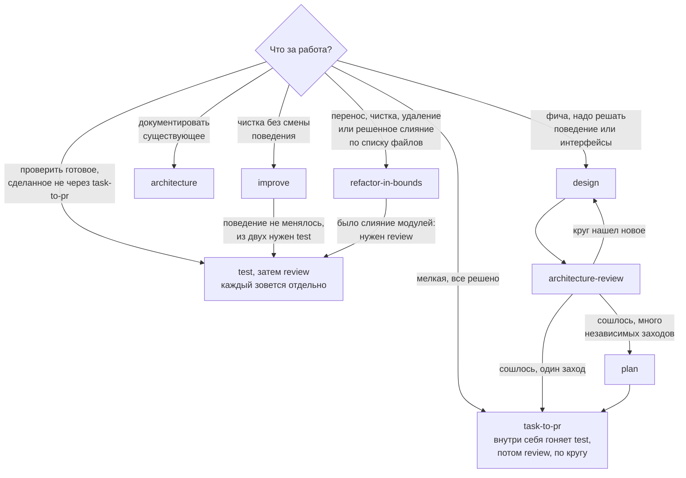

# Процесс разработки

Как изменение идет от задачи до слияния в dev: какой скилл когда зовется, чем доказывается правка, что идет через аппрув владельца. Не проверяется, тесты держат только знаки и ссылки документа, механическую часть правил держат хуки, они названы на месте.

## Выбор пути

Процесс собран из скиллов [owainlewis/blueprint](https://github.com/owainlewis/blueprint) и наших дополнений. Скиллы лежат в `.claude/skills/`, кроме `requirement-ledger` (раздел о наших скиллах ниже). Источник и хеш каждого скилла блюпринта записаны в `skills-lock.json`, наших там нет. Агент зовет скилл сам, когда задача совпадает с описанием, ручной вызов `/имя` нужен, только чтобы заставить.



`test` и `review` это шаги 3 и 7 первой фазы task-to-pr, и их круги повторяются внутри него, пока очередной находит новое (шаг 8). Поверх завершенного task-to-pr их заново не гоняют. Отдельно они зовутся для работы, сделанной не через task-to-pr: готовой ветки, чужого диффа, ручной правки.

## Скиллы

Каждый скилл останавливается в своей точке, чтобы одна фаза не принимала решений другой.

| Скилл | Где останавливается |
|-------|---------------------|
| [architecture](../../.claude/skills/architecture/SKILL.md) | Документ о сделанном, сверенный с кодом, будущего поведения не предлагает |
| [design](../../.claude/skills/design/SKILL.md) | Дизайн с критериями `AC-n` и инвариантами `INV-n` готов к ревью, код не пишет, утверждает владелец |
| [architecture-review](../../.claude/skills/architecture-review/SKILL.md) | Вердикт по предложению, сам дизайн не правит |
| [plan](../../.claude/skills/plan/SKILL.md) | Упорядоченные задачи под отдельные заходы, не реализует |
| [task-to-pr](../../.claude/skills/task-to-pr/SKILL.md) | По адаптации ниже |
| [test](../../.claude/skills/test/SKILL.md) | Отчет pass, fail или unverified по каждому критерию и инварианту |
| [review](../../.claude/skills/review/SKILL.md) | Находки Must, Should и Could fix с уверенностью от 0 до 5, файлы не правит |
| [improve](../../.claude/skills/improve/SKILL.md) | Поведение не меняет, смена поведения идет через task-to-pr |
| [refactor-in-bounds](../../.claude/skills/refactor-in-bounds/SKILL.md) | Только файлы из задания, раздел о нем ниже |
| [codex-issue-coordinator](../../.claude/skills/codex-issue-coordinator/SKILL.md) | Без воркеров Codex останавливается |
| [html-doc](../../.claude/skills/html-doc/SKILL.md) | Одна HTML-страница из одного Markdown-документа, нужны Python, Pandoc, Node и npm |

Проект (`design`) живет вне репозитория, в scratchpad или памяти, и только до реализации. Сделанное уходит в конвенции строкой довода, несделанное в план, и проектов и планов в docs нет. Скилл апстрима пишет проект в папку под docs, а сам скилл не правится, поэтому правило стоит здесь, иначе папка планов заведется заново под другим именем.

## Адаптация task-to-pr

Изменение попадает в dev веткой и PR, одна ветка несет одно изменение ([CLAUDE.md](../../.claude/CLAUDE.md)). Слияние и отказ прямого пуша описаны в [TESTING.md](../guides/TESTING.md), отказ держит PrePushGateShould. Отличия от текста скилла:

- Шаг 1. Ветка создается через `git switch -c` или `git worktree add`: `git checkout` блокирует хук агента [block-dangerous-git.js](../../.claude/hooks/block-dangerous-git.js).
- Шаги 4, 5 и 8 (коммит, пуш, PR, коммит каждой правки по ревью). Агент оставляет правку в рабочем дереве, коммит по именам файлов собирает оркестратор. Пуш ветки и PR идут по слову владельца.

Остальное, вторая фаза с ожиданием CI на PR в том числе, идет как написано.

## Как review сочетается с агентом code-reviewer

Это две половины одного ревью. Скилл `review` задает процесс: свежий агент, не писавший изменение, порядок чтения, формат находок, ревью доказательств. Агент [code-reviewer](../../.claude/agents/code-reviewer.md) знает предмет: RBAC, паттерн Intention, границы модулей, стандарты API, разобранные ложные срабатывания. Скилл говорит, КАК смотреть, агент говорит, ЧТО искать. Запуск ревью значит свежий агент code-reviewer с находками в формате скилла, перевод вердиктов записан в самом агенте.

## Сколько кругов ревью

Проектный документ, который что-то решает, проходит несколько кругов, каждый ведет свежий агент, не видевший ни прошлых кругов, ни ответов на них. Первый круг читает замысел, следующие формулировки: закрытая дыра рождает соседнюю на границе заплатки. Круги кончаются по сходимости, а не по счету, когда очередной приносит не новые дыры, а следствия уже названного принципа. Пока раздел растет списком "а еще вот так", он не сошелся.

Одного круга хватает документу, который ничего не решает: пересказу проверенного кода, каталогу видимых изменений, записке о решении владельца. В таком документе нет разделов "почему так, а не иначе".

## Ревью в двух рамках

Документ смотрят два отдельных агента. Первая рамка безопасность и корректность: что сломается, что утечет, где решение неверно. Вторая соразмерность и цена: сколько стоит, что ломает из работающего, есть ли результат дешевле. Рамка задает, что считается находкой, и ревьюер с обеими рамками сразу выдает усредненный ответ, в котором не видно ни одной оценки. Результаты сводит автор, разошедшиеся оценки остаются в тексте названным выбором.

## Проверенное и правдоподобное

Проверенное утверждение несет доказательство на месте: файл и имя в нем, вывод команды, замер. Непроверяемое либо помечено в самом пункте с названием недостающих данных, либо удаляется вместе с доводом, который на нем стоял, оговорка довод не спасает. Оценка объема, частоты или распределения в чужом или будущем источнике это догадка, и такая фраза удаляется целиком, а не смягчается наречием.

## Доказательства: гейты, тесты, живой стенд

Гейты отвечают "ничего не сломано": CI на PR, заранее хук pre-push и `scripts/gates.sh` ([TESTING.md](../guides/TESTING.md)). Скилл `test` отвечает "сделано то, что просили", по ID каждого критерия приемки. Живой стенд отвечает "это видно человеку", и отвечает он один. Изменение готово, когда все три ответа "да".

### Тест обязан падать на сломанном коде

Это проверяется прогоном, а не предполагается. Прежняя версия файла достается из истории командой `git show <ревизия>:<путь> > <путь>` в Git Bash (почему не в PowerShell, сказано в [CLAUDE.md](../../.claude/CLAUDE.md)), тест обязан упасть на том утверждении, ради которого написан, затем возвращается исправленная версия. Восстанавливается файл, а не дерево, соседние правки целы.

Тест, зеленый на сломанном коде, доказывает собственную настройку. Тот же изъян у теста, который проверяет только то, что дубль вернул подготовленное значение ([TESTING.md](../guides/TESTING.md)).

### Вердикт гейта по коду возврата

Гейт пройден или нет по коду возврата команды, а не по хвосту вывода: у упавшего прогона хвост может выглядеть спокойно. Обратная ошибка того же корня: команда, считающая совпадения, при нуле совпадений возвращает ненулевой код, и шаг краснеет без дефекта. Поэтому ненулевой код читается до вердикта (какая команда вернула и о чем она отвечает), а счет совпадений не ставится последней командой шага.

### Живая проверка там, где дефект виден только на стенде

Тест видит то, что ему подали, и дефект "подали не то" не ловит по построению: проекция без поля, фикстура без случая, проход, унесший текст раньше разбора. Утечки приватного текста и отказы страниц находились на стенде при зеленых тестах. Поэтому изменение того, что человек видит на странице, закрывается прогоном по живому стенду от роли, которой это видно, гостя включая. Отчет называет, что открыли и что увидели, а не что должно было получиться.

## Многозонная работа: оркестрация вместо одной задачи

Волна, которая разом правит бэкенд, клиент и документы или закрывает много независимых находок, идет оркестрацией воркфлоу, а не одним task-to-pr. Фазы те же и обязательны:

1. Разбор рисков до кода: что затрагивается, какие права и границы меняются, что сломается у соседей. Роль `architecture-review`.
2. Реализация с тестами по зонам, не пересекающимся по файлам.
3. Ревью или сравнение по правилу [чем доказывается правка](#чем-доказывается-правка). Ревью всего, что меняет доступ, строит таблицу "что обещает клиент против того, что разрешает сервер".
4. Доказательства по каждому измененному поведению. Роль `test`.

Первую фазу не пропускают: перестроенная без нее премодерация игр вышла нерабочей, а ручка премодерации блога без ролевого замка стала оракулом существования скрытого блога. Такое ловит разбор до кода, а не ревью после, которое читает написанное, а не то, что следовало решить иначе.

### Зоны, прогоны, коммиты

Зона это набор файлов, а не тема. Агент не трогает чужой файл ни строкой: его правит другой агент, и правка пропадет под чужой записью или уедет в чужой коммит. Нужное соседу агент возвращает оркестратору словами. Задачи, пересекшиеся по файлам, идут по очереди, иначе дифф не разрезать на отдельные изменения.

Документ, описывающий экраны, идет после зон, которые их строят: написанный раньше, он описывает замысел.

Сборка и тестовая база общие на все рабочее дерево, поэтому прогоны разводятся по времени, а массовое падение читается как дефект только после проверки, что рядом не шел второй прогон ([TESTING.md](../guides/TESTING.md)).

Коммитит оркестратор, по именам файлов из отчета агента: одна зона, один коммит.

## Задания агентам и проверка

### Задание

Задание укладывается примерно в сто шагов агента: каждый шаг заново читает все накопленное, и цена растет быстрее числа шагов. Зона больше этого делится на два-три задания подряд с передачей итога файлом.

В задание кладется нужный агенту кусок плана и правил, а не ссылка на общий документ, иначе каждый агент читает документ целиком ради абзаца. Модель и глубина мышления выбираются по правилу [CLAUDE.md](../../.claude/CLAUDE.md) и называются в задании и в отчете.

### Чем доказывается правка

Свежий ревьюер обязателен, когда правка меняет устройство кода (логику, границы модулей, интерфейсы) или касается доступа, данных или безопасности: верность нового решения видит только читающий.

Остальная правка поведения (константа, конфиг, текст, стиль) доказывается тестом затронутого и стендом, кадрами и снимком ответов API, а разница сверяется с заданием. Видимая все равно идет через аппрув.

Правка, обещающая ничего не изменить (перенос, чистка, удаление неиспользуемого), доказывается сравнением до и после: вид стендом кадров [scripts/visual](../../scripts/visual/README.md) попиксельно, ответы сервера его снимком ответов API, код `scripts/visual/compare-code.mjs`. Команды и условие для серверной правки описаны в скилле [refactor-in-bounds](../../.claude/skills/refactor-in-bounds/SKILL.md). Сравнение отвечает на вопрос "изменилось ли" точно, ревьюер на глаз.

Во время шага идут тесты затронутого: спеки и гейты-реестры правленых файлов, тестовые проекты правленых модулей. Полный набор гонит CI раз в сутки, а в конце волны его дает `DM_GATES_FULL=1 bash scripts/gates.sh`.

## Видимые изменения идут через аппрув

Видимое изменение предлагается владельцу до реализации нумерованным каталогом, по пункту на изменение, и делается ровно выбранное. Функциональное и невидимое делается без каталога.

Граница одним вопросом: нужно ли открыть страницу, чтобы увидеть результат правки. Если да, изменение видимое: цвет и отступ, порядок и состав элементов, формулировка надписи, появление или исчезновение контрола, отклик на наведение и ввод, вид уже сохраненного чужого текста. Починка не исключение, она меняет увиденное так же, как правка замысла, а прежнее поведение могло стать привычным.

Пункт каталога отвечает, как сейчас, как станет и чем платим. Цена называется и нулевая, иначе пункт читается как реклама. Нынешнее поведение сверяется с кодом, а не пересказывается по памяти, и расхождение с прежним описанием называется в пункте.

Варианты на выбор показываются подстановкой стиля в открытую страницу, исходники меняются один раз, по выбранному. Лист "сейчас и станет" собирается из кадров одного состояния и размера, а не из ручных обрезок, и после правки переснимается тем же способом.

Исключения владелец дает поименно, и записываются они рядом с правилом, которое сужают.

## Документ разработки

Спеки в репозитории нет: план и недостроенное живут вне его, сделанное описывает код и [STATUS.md](../STATUS.md).

## Наши скиллы вне блюпринта

`requirement-ledger`, журнал указаний и аппрувов владельца, живет в памяти агента: это журнал поручений исполнителю, а не часть продукта, и он переживает сжатие разговора.

`refactor-in-bounds` правит только файлы из задания, вид и поведение не меняет, каждый шаг доказывает сравнением до и после, а решенное заданием слияние модулей еще и свежим ревьюером. От `improve` он отличается целью, заданной списком, и доказательствами из нашего набора. Апстрима у него нет, в `skills-lock.json` он не записан и правится как наш документ.

Бывший скилл skeleton-parity расформирован, его пометка в коде клиента отсылает к разделу "Геометрический паритет" в [UI_STANDARDS.md](UI_STANDARDS.md).

## Тексты скиллов блюпринта не правятся

Скиллы блюпринта остаются байт в байт апстримными. Наша специфика (адаптация task-to-pr, связка review с code-reviewer, перевод вердиктов) живет в обвязке: этом файле, `CLAUDE.md` и `.claude/agents/`. Тогда обновление сводится к перезаписи, а правленый скилл пришлось бы каждый раз сливать с апстримом руками, и забытое слияние молча откатило бы правку. Новый порядок работы заводится своим скиллом, а поведение скилла блюпринта, которое обвязкой не выразить, меняется осознанным форком с записью здесь.

## Обновление скиллов

```bash
npx skills add owainlewis/blueprint
```

Затем содержимое `.agents/skills/` переносится в `.claude/skills/` обычными файлами, а `.agents/` удаляется: установщик кладет симлинки с абсолютным путем машины. Хеши в `skills-lock.json` CLI `skills` считает своим алгоритмом, sha256 файла с ними не совпадает, поэтому расхождение с апстримом проверяется повторным `npx skills add`.

Выключить скилл, не удаляя: `skillOverrides` в `.claude/settings.local.json` со значением `off`, такой скилл агент не видит.
